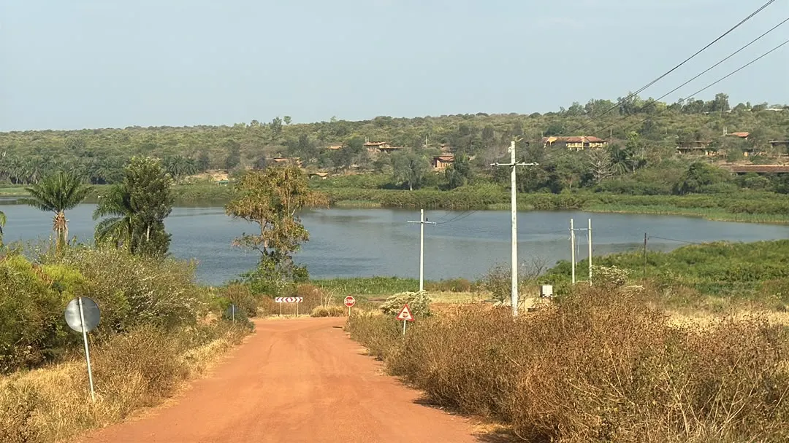
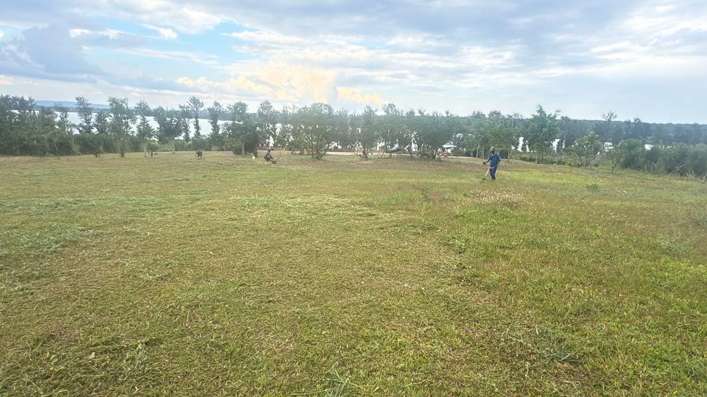

# The farm today

Status: updated 2026-10-28. From the founder and the owner, and the photos of 2026-10-25 and 2026-10-28; nothing here is surveyed yet.

What the farm is, where it is and what already stands on it, so every guide starts from the same facts.

## The land

- About 5 ha [founder, 2026-10-28; not surveyed].
- An upside-down L: a wide strip across the top and a tall block on the right, as in the founder's sketch. Scaled to 5 ha it is about 280 × 255 m overall, the block about 145 m wide and the strip about 100 m deep [E, from the sketch only].
- The compound (containers, camp, bar, study room) is in the right block. The field for vegetables and livestock is the top-left arm, behind the study room (D-027).
- The lake is in view across a neighbour's plot; it is not on the farm. The lake rules (no structure within 50 m of the flood line, no livestock house within 200 m) are probably met, but they are measured once there is a pin [U].
- Still needed: a Google Maps pin of the gate, or the land-title UPI, whose parcel plan gives the true boundary and area.

## Where

- Gashora sector, Bugesera district, Eastern Province, about an hour from Kigali (D-017).
- About 930 mm of rain a year in two rainy seasons; the sector is ringed by declared swamps ([location research](../../study/research/location.md)).

## What stands today

- **Containers:** red and yellow 20 ft boxes on steel decks about 700 mm up, with red pipe rails; the yellow joined pair with red doors (the future guest rooms); a teal 40 ft box; a red 20 ft kiosk (the future bar).
- **A brick building** behind the containers; its use is not decided [U].
- **The camping lawn:** pop-up tents, reed screens, thatched and coloured umbrellas, a round concrete fire pit, string lights for events. It has already hosted night camps with covered tables.
- **Sport:** a volleyball net on the lawn. The planned court, 18 × 9 m, is drawn on [its page](/en/volleyball) and beside the compound on [the farm plan](/#plans).
- **Trees:** rows of young trees, palms, and a tall, slim tree line toward the lake.
- **Arrival:** a timber X-braced gate on a concrete apron; red laterite roads; power poles along the road down to the lake.

## Water, power and waste, as reported

- **Power:** the founder reports the national grid (REG) on site ([studio site](../../study/studio/studio-site.md)), and power poles run along the road. Grid, solar or both: the [power guide](electric.md).
- **Water:** the founder reports mains water (WASAC), a borehole and rainwater; the borehole's yield and quality are not tested [U].
- **Waste:** no septic system yet. One is planned at least 50 m from the borehole, and no guest stays before it passes its inspection (D-016).

## Open questions

1. The pin or the UPI: the true boundary, the area and the distance to the lake.
2. The brick building: keep it and give it a use (store, workshop, kitchen), or take it down?
3. The guest rooms: each with its own shower and WC, or sharing the public bathroom? The plans disagree.
4. The borehole: its yield through June to August, and a water-quality test.
5. The grid: single or three phase, where the meter is, how far the transformer is.
