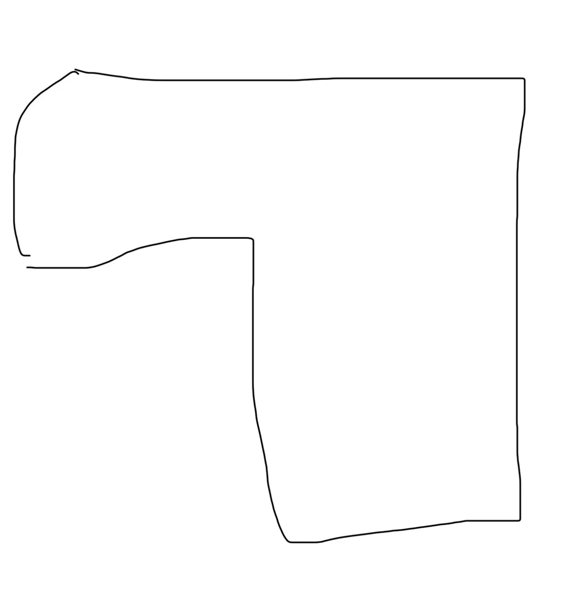
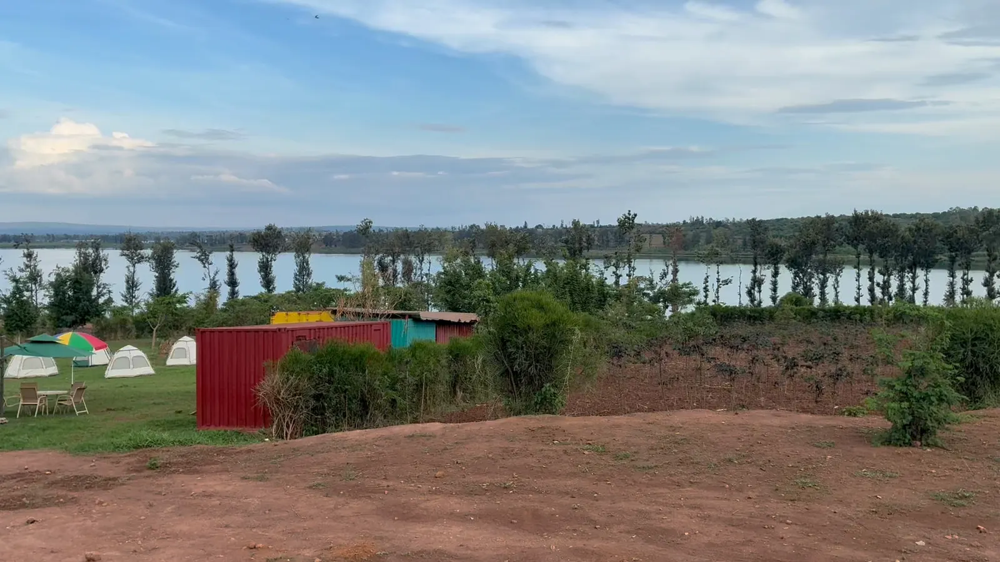
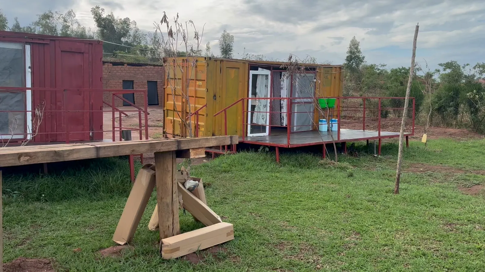
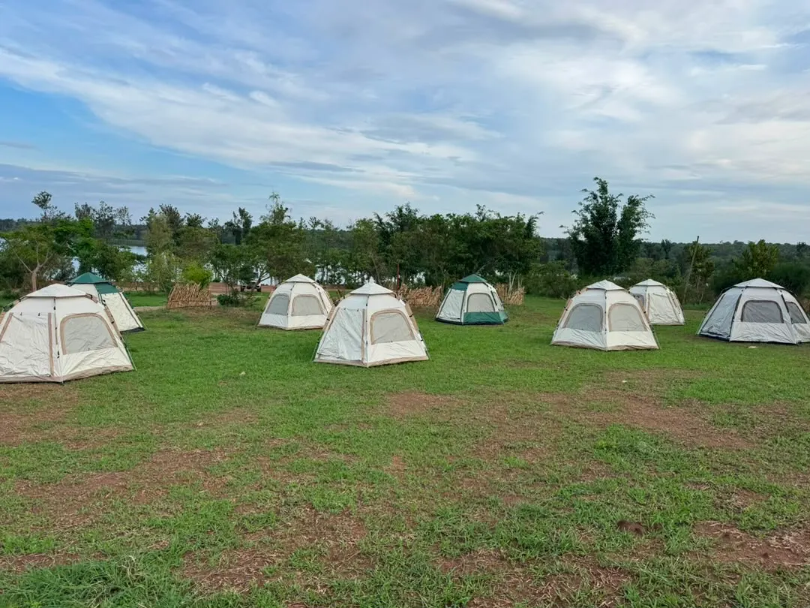
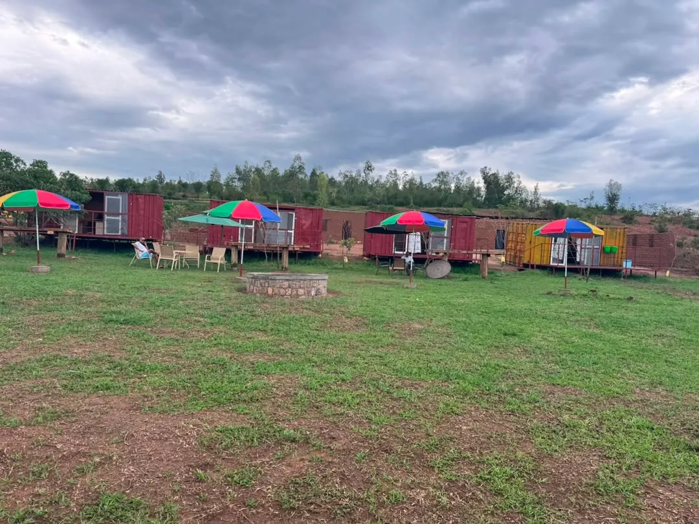
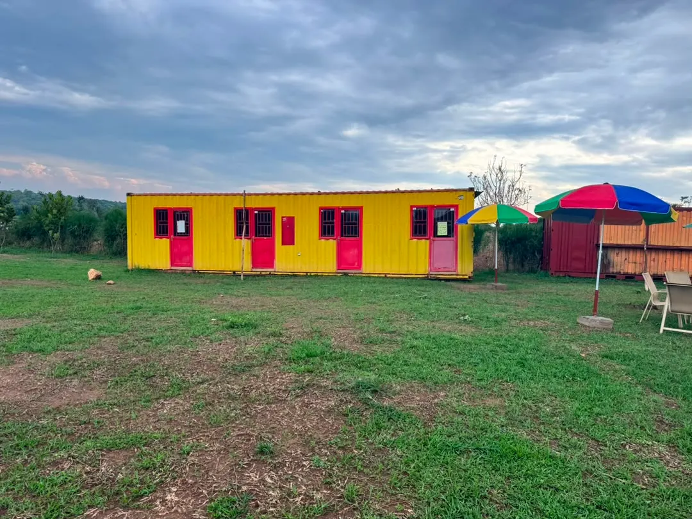
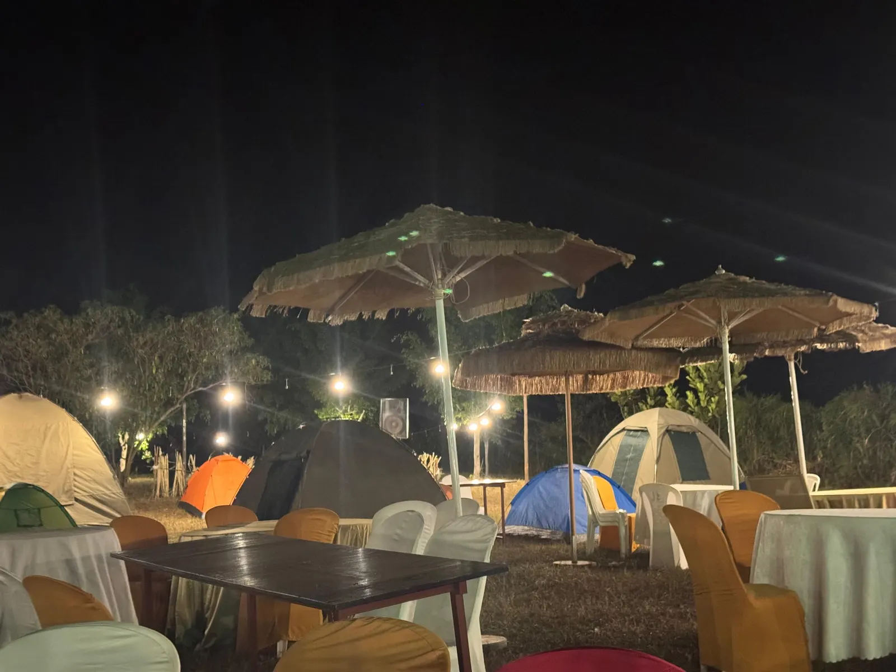

# Ifamu uyu munsi

> **Ubusobanuro:** iyi nyandiko yahinduwe na mudasobwa (machine draft). Igomba gusuzumwa n'umuntu uvuga Ikinyarwanda kavukire mbere yo kuyiha abakozi. Iyo hari itandukaniro, kurikiza iy'Icyongereza.

Status: byavuguruwe ku wa 2026-10-28. Bivuye kuri nyir'umushinga (founder) na nyir'ubutaka (owner), no ku mafoto yo ku wa 2026-10-25 n'ayo ku wa 2026-10-28; nta kintu na kimwe hano kirapimwa.

Ifamu icyo ari cyo, aho iri n'ibyamaze kuyubakwaho, kugira ngo amabwiriza yose ahere ku makuru amwe.

English: [read this page in English](today.md)

## Ubutaka

- Hafi 5 ha [founder, 2026-10-28; ntiburapimwa].
- Imiterere ya L icuritse: umurongo mugari hejuru n'igice kirekire iburyo, nk'uko biri ku gishushanyo cy'intoki cya nyir'umushinga. Bibazwe kuri 5 ha, muri rusange ni hafi 280 × 255 m, igice cy'iburyo gifite ubugari bwa hafi m 145 n'umurongo wo hejuru ufite uburebure bwa hafi m 100 [E, bivuye ku gishushanyo cy'intoki gusa].
- Urugo rw'inyubako (compound: kontineri, ingando, akabari, icyumba cyo kwigiramo) ruri mu gice cy'iburyo. Umurima w'imboga n'amatungo ni ukuboko ko hejuru ibumoso, inyuma y'icyumba cyo kwigiramo (D-027).
- Ikiyaga kiragaragara hakurya y'isambu y'umuturanyi; ntikiri ku ifamu. Amategeko y'ikiyaga (nta nyubako muri m 50 uvuye ku murongo w'imyuzure, nta nzu y'amatungo muri m 200) birashoboka ko yubahirizwa, ariko azapimwa pin imaze kuboneka [U].
- Biracyakenewe: pin ya Google Maps y'irembo, cyangwa UPI y'icyangombwa cy'ubutaka, igishushanyo cy'ikibanza (parcel plan) cyayo kikaba ari cyo gitanga imbibi nyazo n'ubuso nyabwo.

## Aho iri

- Umurenge wa Gashora, akarere ka Bugesera, Intara y'Iburasirazuba, hafi isaha imwe uvuye i Kigali (D-017).
- Hafi mm 930 z'imvura ku mwaka mu bihembwe bibiri by'imvura; umurenge uzengurutswe n'ibishanga byatangajwe ([ubushakashatsi ku hantu](../../study/research/location.md)).

## Ibihagaze uyu munsi

- **Kontineri:** udusanduku dutukura n'umuhondo twa 20 ft kuri deck z'icyuma ziri hejuru nka mm 700, zifite uruzitiro rw'amatiyo atukura; kontineri ebyiri z'umuhondo zifatanye, zifite inzugi enye zitukura buri rumwe rufite idirishya ririho ibyuma (ibyumba by'abashyitsi bizaza); agasanduku k'umuhondo n'aka teal biri munsi y'igisenge kimwe cy'amabati; akazu gatukura ka 20 ft (akabari kazaza).
- **Inzu y'amatafari** inyuma ya kontineri; icyo izakoreshwa ntikiremezwa [U].
- **Ibyatsi by'ingando:** amahema ya pop-up, inzitiro z'urubingo, imitaka isakajwe n'iy'amabara, aho bacana umuriro hazengurutse h'isima (fire pit), amatara y'imirongo y'ibirori. Hamaze kwakira ibirori mu gihe cy'izuba, bifite imitaka isakajwe ikodeshejwe, intebe zitwikiriye n'amahema ameze nk'inkuge (dome tents).
- **Siporo:** urushundura rwa volleyball ku byatsi. Ikibuga giteganyijwe, 18 × 9 m, gishushanyije ku [rupapuro rwacyo](/en/volleyball) no iruhande rw'urugo rw'inyubako ku [gishushanyo cy'ifamu](/#plans).
- **Ibiti:** imirongo y'ibiti bikiri bito, imikindo, n'umurongo w'ibiti birebire binanutse ugana ku kiyaga.
- **Kuhagera:** irembo ry'icyuma ry'umurima (steel field gate) n'icyapa ku gisima cya beto cyasadutse; inzira z'itaka ritukura (laterite).

## Amazi, umuriro n'imyanda, nk'uko byavuzwe

- **Umuriro:** nyir'umushinga avuga ko umuyoboro w'amashanyarazi w'igihugu (REG) uri ku kibanza ([ikibanza cya sitidiyo](../../study/studio/studio-site.md)); kontineri y'ibiro ifite amatara yaka. Grid, imirasire y'izuba cyangwa byombi: [amabwiriza y'umuriro](electric.md).
- **Amazi:** nyir'umushinga avuga ko hari umuyoboro rusange w'amazi (WASAC), borehole n'amazi y'imvura; amazi borehole itanga n'ubwiza bwayo ntibirageragezwa [U].
- **Imyanda:** nta septic system irabaho. Iteganyijwe nibura kuri m 50 uvuye kuri borehole, kandi nta mushyitsi ucumbika mbere y'uko itsinda igenzura ryayo (D-016).

## Ibibazo bitarasubizwa

1. Pin cyangwa UPI: imbibi nyazo, ubuso n'intera igera ku kiyaga.
2. Inzu y'amatafari: kuyigumana ikagira icyo ikoreshwa (ububiko, atelier, igikoni), cyangwa kuyisenya?
3. Ibyumba by'abashyitsi: ibyumba bitatu, buri kimwe gifite douche yacyo na WC (D-061). Ni izihe nzugi n'amadirishya muri enye ziriho uyu munsi bizafungwa cyangwa bikimurwa kubera byo? Ipima ry'Umunsi wa 1 ni ryo rizabyemeza.
4. Borehole: amazi itanga kuva muri Kamena kugeza muri Kanama, n'igerageza ry'ubwiza bw'amazi.
5. Grid: single cyangwa three phase, aho mubazi (meter) iri, n'intera transformateur iriho.
