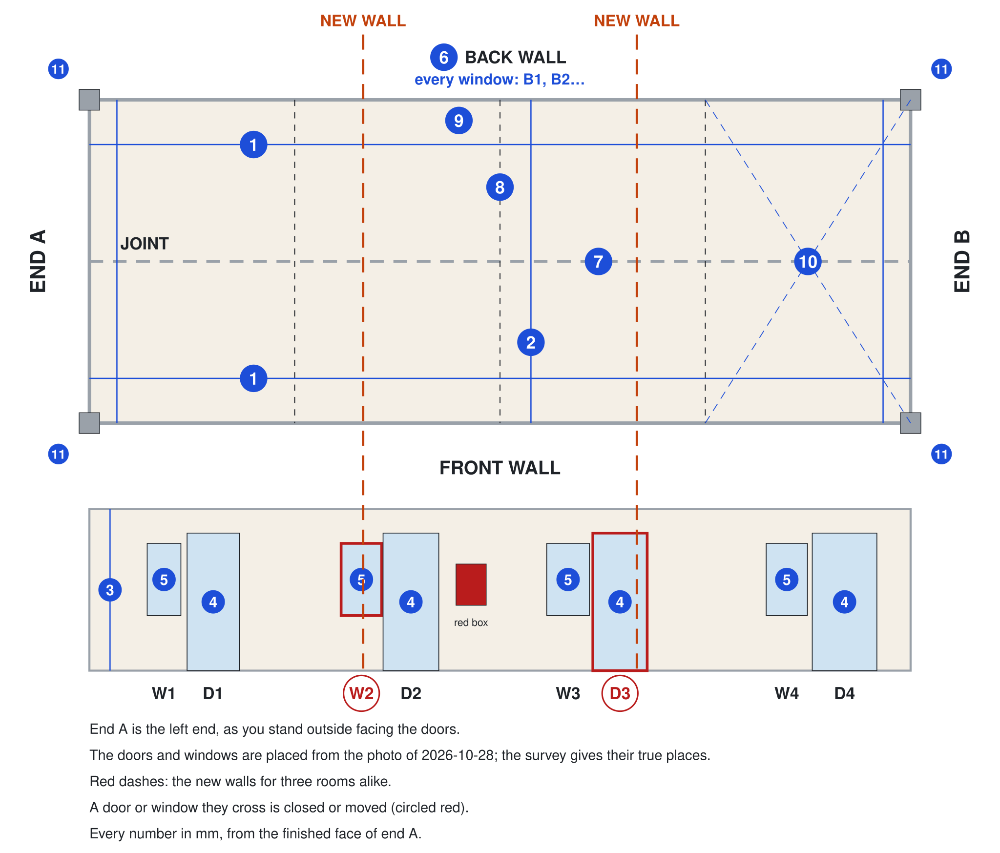

# Guest room: execution plan

Status: decided 2026-10-31 (D-061): three rooms alike, each with its own shower, WC and basin, and no kitchen; meals come from the galley. The block is not measured yet: until the Day 1 survey, every size is design intent [A] and every opening's place comes from a photo [E].

Every step of fitting out the three guest rooms in the joined 40 ft pair, in the studio's order, from the survey to the first guest.

The three rooms are the same, so one plan serves all three.

Kinyarwanda: [soma iyi gahunda mu Kinyarwanda](plan.rw.md) · The rooms drawn: [the guest room page](/en/guest-room) · Its other pages: [materials](materials.md), [electric](electric.md), [plumbing](plumbing.md) · Each step done in full: [the studio's plan](../studio/plan.md)

## At a glance

[One guest room from above: the bed under the back window, the bathroom across the front-left corner under the front window, the wardrobe, the desk and the veranda](../../src/components/guest-room/guest-room-plan.tsx#GuestRoomPlan)

| What | Design |
|---|---|
| The block | two 40 ft containers joined side by side, 12.192 × 4.876 m outside, three rooms alike, on a 0.3 m stone plinth |
| One room | 4.064 m along the block and 4.876 m deep, with a 1.5 m timber veranda in front |
| Inside | a 160 × 200 cm double bed under the back window with a bedside table and a lamp on each side, a wardrobe, a desk; no kitchen |
| Bathroom | its own, across the front-left corner behind a sliding door: a walk-in shower on a 900 × 900 tray with an instant heater, a WC and a basin; the front window becomes its window |
| Services | electric on a 63 A main switch, the shower heater on its own circuit ([electric](electric.md)); water, drains and a vent for the bathroom ([plumbing](plumbing.md)) |

**What stands today.** The block is four rooms now: four red doors, D1 to D4, each with a barred window on its left, W1 to W4. Three rooms alike need a new wall about every 3,980 mm, and the photo puts W2 and D3 on those lines [E]: the survey settles which openings close or move. Inside, the partitions are torn open in places, the plywood floor is damaged, and the steel rail where the two containers join runs across the floor.

## Before you start

Chalk A on end A, the left end as you stand outside facing the doors, and D1 to D4 on the doors. Then measure these 11 numbers, in mm, from the finished face of end A:

1. **Length**, 1 m above the floor: along the front wall and along the back wall.
2. **Depth**, front wall to back wall, 1 m above the floor: at end A, in the middle and at end B.
3. **Height**, floor to ceiling: in the middle of a room, and under the cove or the beam.
4. **Each door, D1 to D4:** where it starts and where it ends, and its height.
5. **Each front window, W1 to W4:** where it starts and where it ends, its sill and its head.
6. **Each back window:** the same; number them B1, B2 and so on from end A.
7. **The joint:** where each steel post starts and ends, the height under the beam, and the floor rail's width and how far it stands above the floor.
8. **Each partition standing:** where it is, and how thick.
9. **The lining:** steel to finished face, where a board is broken, in a wall and in the ceiling.
10. **Each room's floor:** both diagonals (write the difference) and the level (highest corner minus lowest); mark soft or rotten spots on the drawing.
11. **Outside:** the floor's height above the ground at the four corners.

Then:

1. Photograph each room's four walls, floor and ceiling; the joint at the floor and at the ceiling; the front, the back and both ends; the roof from a ladder; and under each corner.
2. Send the numbers and the photos the same day; they go into [the survey](#the-survey).
3. Book the welder: closing or moving an opening is hot work, done with the studios' (S01).
4. Decide with the carpenter whether the linings stay and are patched, or come out so the rooms are lined as the studio is.

## Steps

1. **Welder:** close or move the openings the new walls cross, and any other hot work the survey finds, before anything that can burn goes in.
2. **Carpenter:** strip out the broken boards and the old partitions; open up any soft floor and check it for rot.
3. **Carpenter:** the membrane and the floor sheets, then the battens, as in [the studio's plan](../studio/plan.md); then the frames of the new partitions and of each bathroom.
4. **Electrician and plumber:** the first fix: the cables for every circuit ([electric](electric.md)); the supply, the drains and the vent for each bathroom ([plumbing](plumbing.md)).
5. **Tests before the walls close:** continuity and insulation on every cable; the pipes hold 10 bar for one hour; photograph every wall; sign the release.
6. **Insulation and linings:** insulate between the battens and fix the linings, as the studio does [A].
7. **Plumber and carpenter:** each bathroom as the studio's (S06 to S10): the membrane, the tray, the tiles, the WC, the basin and the heater.
8. **Carpenter:** the oak planks, then the furniture ([materials](materials.md)): the bed, the bedside tables, the bench, the wardrobe, the desk and the hooks.
9. **Electrician:** the second fix (the board, the lights, the wall fan, the sockets, the heater, the AC isolator and the smoke alarm), then the tests and the certificate.
10. **Carpenter:** the veranda's boards, its steps and the slatted shade; its chairs and table.
11. **Owner:** the bedding, the lamps and the rug; photograph each room.

## Hold points

1. **Measure before you cut.** Nothing is cut, welded or ordered before the block is measured and the three rooms are drawn on it.
2. **No welding after the insulation.** All hot work comes first.
3. **Nothing buried untested.** The cables pass their tests and the pipes hold 10 bar for one hour before the linings close.
4. **No power on before the certificate.** A RURA-licensed electrician signs the tests first.
5. **No guest before the septic passes its inspection** (D-016).

## Done when

1. The electrical tests pass and the certificate is signed.
2. The pipes held 10 bar before the linings closed, the drains are fill-tested, and the shower holds about 40 °C at full flow.
3. Each room has its bed with a lamp on both sides (D-029), its wardrobe and desk, its own shower, WC and basin, and its veranda chairs.
4. The farm's septic system has passed its inspection (D-016).

## The survey

The numbers from the site, each with the date it was measured. Until a row has a value, the drawings stay design intent.

[Table: The guest-room block, measured on Day 1](../../study/guest-room/survey.csv)

## Open questions

1. Which openings close or move? The photo puts W2 and D3 on the new walls; the survey settles it.
2. Do the existing linings stay and get patched, or come out so the rooms are lined as the studio is?
3. Floor sheets 12 mm, or 18 mm if the old floor is more than 5 mm out over 2 m?
4. The bathroom's window is its only air [A]: is an extract fan needed?
5. The hero shows a teal block with cream doors; the drawings keep the saffron block with red barred doors. Which is the room?
6. Does the AC provision stay, or is the wall fan enough?
