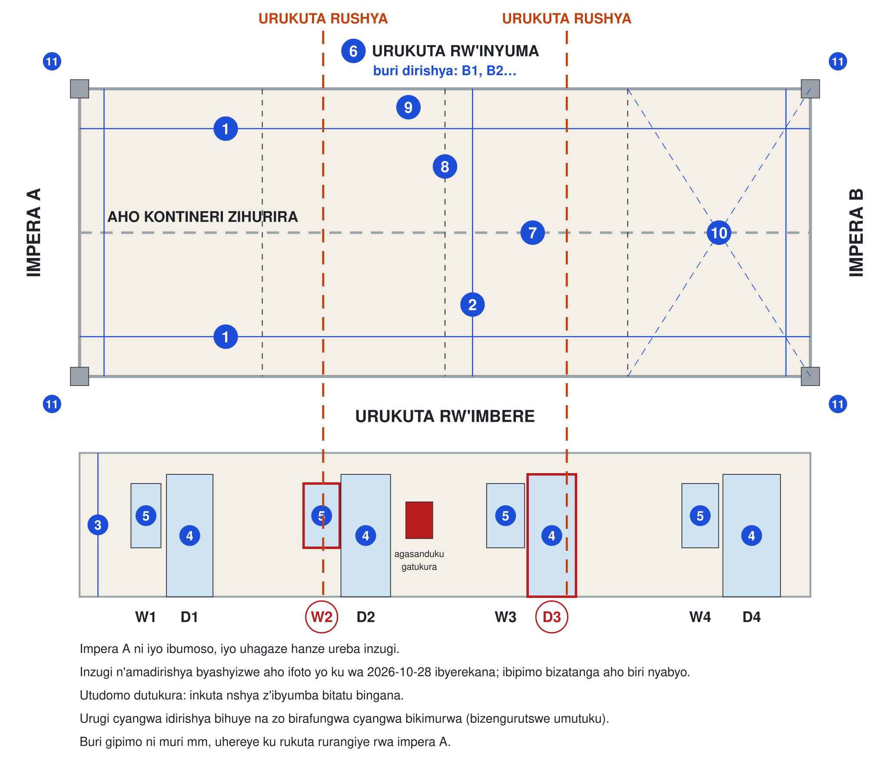

# Icyumba cy'abashyitsi: gahunda y'imirimo

> **Ubusobanuro:** iyi nyandiko yahinduwe na mudasobwa (machine draft). Igomba gusuzumwa n'umuntu uvuga Ikinyarwanda kavukire mbere yo kuyiha abakozi. Iyo hari itandukaniro, kurikiza iy'Icyongereza.

Status: byemejwe ku wa 2026-10-31 (D-061): ibyumba bitatu bisa, buri cyumba gifite douche yacyo, WC na lavabo, nta gikoni; amafunguro ava muri galley. Inyubako ntirapimwa: kugeza ku bipimo by'Umunsi wa 1, buri gipimo ni igitekerezo cy'igishushanyo [A], kandi aho buri rugi n'idirishya biri bivuye ku ifoto [E].

Buri ntambwe yo gutunganya ibyumba bitatu by'abashyitsi muri kontineri ebyiri za 40 ft zifatanye, ku murongo wa sitidiyo, uhereye ku bipimo kugeza ku mushyitsi wa mbere.

Ibyumba bitatu birasa, bityo iyi gahunda ikora kuri byose uko ari bitatu.

English: [read this plan in English](plan.md) · Ibyumba mu bishushanyo: [urupapuro rw'icyumba cy'abashyitsi](/en/guest-room) · Izindi paji zacyo: [ibikoresho](materials.md), [amashanyarazi](electric.md), [imiyoboro y'amazi](plumbing.md) · Buri ntambwe ikozwe yose: [gahunda ya sitidiyo](../studio/plan.md)

## Mu ncamake

[Icyumba kimwe cy'abashyitsi urebye uri hejuru: igitanda munsi y'idirishya ry'inyuma, ubwiherero mu nguni y'imbere ibumoso munsi y'idirishya ry'imbere, akabati k'imyenda, ameza n'urubaraza](../../src/components/guest-room/guest-room-plan.tsx#GuestRoomPlan)

| Iki | Igishushanyo |
|---|---|
| Inyubako | kontineri ebyiri za 40 ft zifatanye ku ruhande, 12.192 × 4.876 m inyuma, ibyumba bitatu bisa, ku gitereko cy'amabuye cya 0.3 m |
| Icyumba kimwe | 4.064 m mu burebure bw'inyubako na 4.876 m mu bujyakuzimu, n'urubaraza rw'imbaho rwa 1.5 m imbere |
| Imbere | igitanda cya 160 × 200 cm munsi y'idirishya ry'inyuma, gifite akameza n'itara kuri buri ruhande, akabati k'imyenda, ameza; nta gikoni |
| Ubwiherero | bwacyo bwite, mu nguni y'imbere ibumoso inyuma y'urugi runyerera: douche yo kwinjiramo ku tray ya 900 × 900 ifite heater ihita ishyushya amazi, WC na lavabo; idirishya ry'imbere riba iryabwo |
| Ibikorwa remezo | amashanyarazi kuri main switch ya 63 A, heater ya douche ku murongo wayo ([amashanyarazi](electric.md)); amazi, imiyoboro y'amazi yanduye na vent by'ubwiherero ([imiyoboro y'amazi](plumbing.md)) |

**Ibihari uyu munsi.** Ubu inyubako ifite ibyumba bine: inzugi enye zitukura, D1 kugeza D4, buri rugi rufite idirishya rifite ibyuma ibumoso bwarwo, W1 kugeza W4. Ibyumba bitatu bisa bikenera urukuta rushya hafi buri 3,980 mm, kandi ifoto yerekana W2 na D3 kuri iyo mirongo [E]: ibipimo nibyo bizemeza inzugi n'amadirishya bifungwa cyangwa bikimurwa. Imbere, partitions zaciwe ahantu hamwe, hasi h'imbaho za pulayiwudi harangiritse, kandi icyuma aho kontineri zombi zihurira kinyura hasi hagati.

## Mbere yo gutangira

Andika A ukoresheje ingwa (chalk) ku mpera A, iyo ibumoso iyo uhagaze hanze ureba inzugi, na D1 kugeza D4 ku nzugi. Hanyuma upime iyi mibare 11, muri mm, uhereye ku rukuta rurangiye rwa impera A:

1. **Uburebure**, m 1 hejuru ya hasi: ku rukuta rw'imbere no ku rukuta rw'inyuma.
2. **Ubujyakuzimu**, kuva ku rukuta rw'imbere kugeza ku rw'inyuma, m 1 hejuru ya hasi: ku mpera A, hagati no ku mpera B.
3. **Uburebure bwo hejuru**, kuva hasi kugeza ku gisenge: hagati mu cyumba, no munsi ya cove cyangwa ya beam.
4. **Buri rugi, D1 kugeza D4:** aho rutangirira n'aho rurangirira, n'uburebure bwarwo bwo hejuru.
5. **Buri dirishya ry'imbere, W1 kugeza W4:** aho ritangirira n'aho rirangirira, sill yaryo n'umutwe waryo (head).
6. **Buri dirishya ry'inyuma:** kimwe; uyite B1, B2 n'ibindi uhereye ku mpera A.
7. **Aho kontineri zihurira:** aho buri nkingi y'icyuma itangirira n'aho irangirira, uburebure munsi ya beam, n'ubugari bw'icyuma kiri hasi n'uko kirenga hasi.
8. **Buri partition ihagaze:** aho iri, n'ubunini bwayo.
9. **Lining:** kuva ku cyuma kugeza ku rukuta rurangiye, aho urupapuro rwacitse, mu rukuta no mu gisenge.
10. **Hasi ha buri cyumba:** diyagonale zombi (andika itandukaniro) na level (inguni iri hejuru ukuyemo iri hasi); erekana ahantu horoshye cyangwa haboze ku gishushanyo.
11. **Hanze:** uburebure bwa hasi uhereye ku butaka, ku nguni enye.

Hanyuma:

1. Fotora inkuta enye za buri cyumba, hasi n'igisenge; aho kontineri zihurira hasi no ku gisenge; imbere, inyuma n'impera zombi; igisenge cyo hejuru uri ku ngazi; no munsi ya buri nguni.
2. Ohereza imibare n'amafoto uwo munsi; bijya mu [bipimo](#the-survey).
3. Teganya umusuderi: gufunga cyangwa kwimura urugi cyangwa idirishya ni imirimo yo gusudira, ikorwa hamwe n'iya sitidiyo (S01).
4. Mufatanye n'umubaji gufata icyemezo: lining zihari zisigara zigasanwa, cyangwa zikurwamo ibyumba bigashyirwamo lining nk'iya sitidiyo.

## Intambwe

1. **Umusuderi:** gufunga cyangwa kwimura inzugi n'amadirishya inkuta nshya zinyuramo, n'indi mirimo yose yo gusudira ibipimo bigaragaza, mbere y'uko hagira ikintu gishobora gushya cyinjizwamo.
2. **Umubaji:** gukuramo imbaho zacitse na partitions za kera; gufungura ahantu horoshye hasi no kureba niba haboze.
3. **Umubaji:** membrane n'impapuro za hasi, hanyuma ibiti (battens), nko muri [gahunda ya sitidiyo](../studio/plan.md); hanyuma amakadiri ya partitions nshya n'ay'ubwiherero bwa buri cyumba.
4. **Umuyagankuba n'umufundi w'amazi:** first fix: insinga za buri murongo ([amashanyarazi](electric.md)); amazi yinjira, imiyoboro y'amazi yanduye na vent bya buri bwiherero ([imiyoboro y'amazi](plumbing.md)).
5. **Igerageza mbere y'uko inkuta zifungwa:** continuity na insulation kuri buri nsinga; amatiyo agumana bar 10 mu isaha imwe; fotora buri rukuta; usinye uruhushya (release).
6. **Insulation na lining:** shyira insulation hagati y'ibiti hanyuma ushyireho lining, nk'uko sitidiyo ibikora [A].
7. **Umufundi w'amazi n'umubaji:** buri bwiherero nk'ubwa sitidiyo (S06 kugeza S10): membrane, tray, amakaro, WC, lavabo na heater.
8. **Umubaji:** imbaho z'igiti (oak planks), hanyuma ibikoresho byo mu nzu ([ibikoresho](materials.md)): igitanda, utumeza two ku mpande z'igitanda, intebe ndende, akabati k'imyenda, ameza yo kwandikiraho n'udufata imyenda (hooks).
9. **Umuyagankuba:** second fix (board, amatara, fan yo ku rukuta, prises, heater, isolator ya AC na alarm y'umwotsi), hanyuma igerageza n'icyemezo (certificate).
10. **Umubaji:** imbaho z'urubaraza, intambwe zarwo n'igicucu cy'imbaho (slatted shade); intebe n'ameza byarwo.
11. **Nyir'ifamu:** amashuka, amatara n'itapi; fotora buri cyumba.

## Ingingo zo guhagarara ukagenzura (hold points)

1. **Pima mbere yo gukata.** Nta kintu gikatwa, gisudirwa cyangwa gitumizwa mbere y'uko inyubako ipimwa n'ibyumba bitatu bigashushanywa kuri yo.
2. **Nta gusudira nyuma ya insulation.** Imirimo yose yo gusudira ikorwa mbere.
3. **Nta kintu gihishwa kitageragejwe.** Insinga zitsinda igerageza n'amatiyo akagumana bar 10 mu isaha imwe mbere y'uko lining zifungwa.
4. **Nta muriro mbere y'icyemezo.** Umuyagankuba ufite uruhushya rwa RURA abanza gusinya ku igerageza.
5. **Nta mushyitsi mbere y'uko septic itsinda igenzura ryayo** (D-016).

## Byarangiye iyo

1. Igerageza ry'amashanyarazi ryatsinze kandi icyemezo (certificate) cyasinywe.
2. Amatiyo yagumanye bar 10 mbere y'uko lining zifungwa, imiyoboro y'amazi yanduye yageragejwe yuzuzwa amazi, kandi douche igumana hafi 40 °C iyo ifunguye yose.
3. Buri cyumba gifite igitanda cyacyo gifite itara ku mpande zombi (D-029), akabati k'imyenda n'ameza, douche yacyo, WC na lavabo, n'intebe z'urubaraza.
4. Septic system y'ifamu yatsinze igenzura ryayo (D-016).

## Ibipimo

Imibare ivuye ku kibanza, buri umwe n'itariki wapimiweho. Kugeza umurongo ufite agaciro, ibishushanyo biguma ari igitekerezo cy'igishushanyo. Inyandiko (note) ziri mu Cyongereza: umubare uri imbere ya buri imwe ni nimero y'igipimo ku rutonde ruri hejuru.

[Table: Inyubako y'ibyumba by'abashyitsi, yapimwe ku Munsi wa 1](../../study/guest-room/survey.csv)

## Ibibazo bitarasubizwa

1. Ni izihe nzugi n'amadirishya bifungwa cyangwa bikimurwa? Ifoto yerekana W2 na D3 ku nkuta nshya; ibipimo nibyo bizabyemeza.
2. Lining zihari zisigara zigasanwa, cyangwa zikurwamo ibyumba bigashyirwamo lining nk'iya sitidiyo?
3. Impapuro za hasi mm 12, cyangwa mm 18 niba hasi ha kera hatarangana birenze mm 5 kuri m 2?
4. Idirishya ry'ubwiherero niryo ryonyine rizana umwuka [A]: hakenewe fan ikurura umwuka (extract fan)?
5. Ifoto nkuru (hero) yerekana inyubako y'ubururu-icyatsi (teal) ifite inzugi z'ibara rya kirimu; ibishushanyo bigumana inyubako y'umuhondo (saffron) ifite inzugi zitukura zifite ibyuma. Ni ikihe cyumba nyacyo?
6. AC iteganyijwe igumaho, cyangwa fan yo ku rukuta irahagije?
