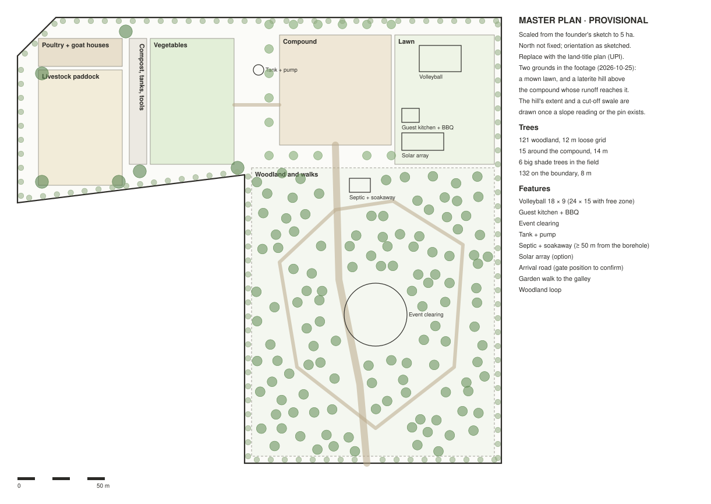
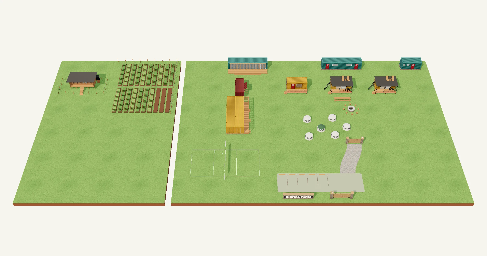

# Master plan: how the farm fits together

Status: provisional, 2026-10-28. Scaled from the founder's sketch; the boundary, north and the gate come from the land title (UPI) or a survey.

The whole farm on one sheet: where each part goes, the trees, the paths and the services, and the rules that keep them apart.

## The land

| What | Size |
|---|---|
| Area | {{site.area_ha}} ha ({{site.area_m2}} m²) [E, from the sketch] |
| Overall | about {{site.width_m}} × {{site.depth_m}} m |
| The block, for the compound and the woodland | about {{site.block_w_m}} m wide |
| The arm, for the field | about {{site.arm_depth_m}} m deep |

## The zones

| Zone | Size | What goes there |
|---|---|---|
| Compound | {{site.compound_m2}} m² (64 × 63 m) | The nine containers, the courtyard, the camp and the fire pit, as on the homepage plan |
| Vegetables | {{site.veg_m2}} m² | Beds 1.2 m wide with 0.5 m paths and drip lines, nearest the galley |
| Compost, tanks, tools | a 10 m strip | Between the beds and the animals |
| Livestock paddock | {{site.paddock_m2}} m² | Fenced, with shade trees at the corners |
| Poultry and goat houses | {{site.houses_m2}} m² | Sited only after the 200 m lake check |
| Lawn | beside the compound | Volleyball ([its page](/en/volleyball)), the guest kitchen and BBQ, the solar option |
| Woodland and walks | {{site.woodland_m2}} m² | The forest: trees on an even, loose grid, a loop walk, an event clearing |

The homepage draws the compound with its nearest neighbours: the volleyball court on the lawn, and the vegetable field and the livestock house drawn close, their true distances being the ones on this sheet. See [the farm plan](/#plans) and [its 3D model](/#model).

## The trees: an even forest

1. **Woodland:** one canopy tree every 12 m on a staggered grid, each moved up to a third of the spacing at random, so it looks even from afar and natural up close: {{site.trees_woodland}} trees.
2. **Around the compound:** a looser ring every 14 m, 6 m out from the containers, for shade without leaves on the roofs: {{site.trees_compound}} trees.
3. **In the field:** a few big shade trees at the paddock corners and the bed edges, never over the beds: {{site.trees_field}} trees.
4. **On the boundary:** a row every 8 m, 2 m in from the line: {{site.trees_boundary}} trees.
5. **Clearance:** every tree stays 4 m from the containers, beds, houses, the court, the septic, the solar, paths and roads.
6. **Species:** boundary and field trees follow the study's [crop plan](../study/design/crop-plan.md): Grevillea and Markhamia, Gliricidia as a live fence, mango as the fruit tree where water is unproven, and no eucalyptus near crops or the lake. Woodland canopy species are to confirm with the district forester or an RAB nursery [A].

In all, {{site.trees}} trees on the provisional plan.

## Paths and services

- **Arrival road,** 4 m wide, from the gate to the compound; the gate's position is still to confirm.
- **Garden walk,** 2 m, from the beds to the galley.
- **Woodland loop,** 2 m, round the event clearing.
- **Water:** the tank and pump by the compound.
- **Waste:** the septic tank and soakaway at least 50 m from the borehole and downhill of it.
- **Power:** a solar array is an option on the lawn; the power guide decides.

## The rules that set the layout

| Rule | Distance | Source |
|---|---|---|
| No structure within 50 m of the lake's flood line | 50 m | [location research](../study/research/location.md) |
| No livestock house within 200 m of the lake | 200 m | [location research](../study/research/location.md) |
| No building within 20 m of a swamp | 20 m | [location research](../study/research/location.md) |
| The septic tank at least 50 m from the borehole | 50 m | [studio plumbing](../study/studio/studio-plumbing.md) |
| A volleyball court 18 × 9 m with a 3 m free zone all round | 24 × 15 m | FIVB official rules |

## What happens next

1. Get the pin or the UPI, redraw the boundary, and fix north and the gate.
2. Measure the arm's distance to the lake, then site the poultry and goat houses.
3. Peg the zones on the ground and walk them with the owner.
4. After the survey, stake out the trees from a list of each tree's position.
