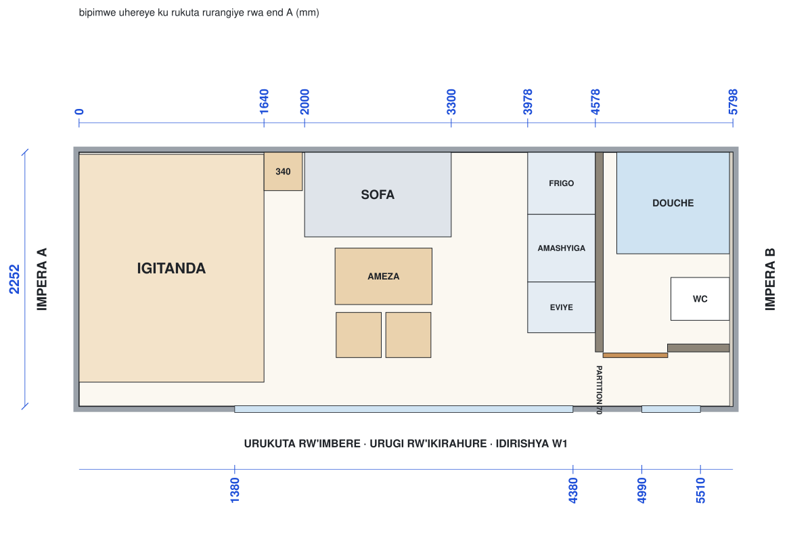
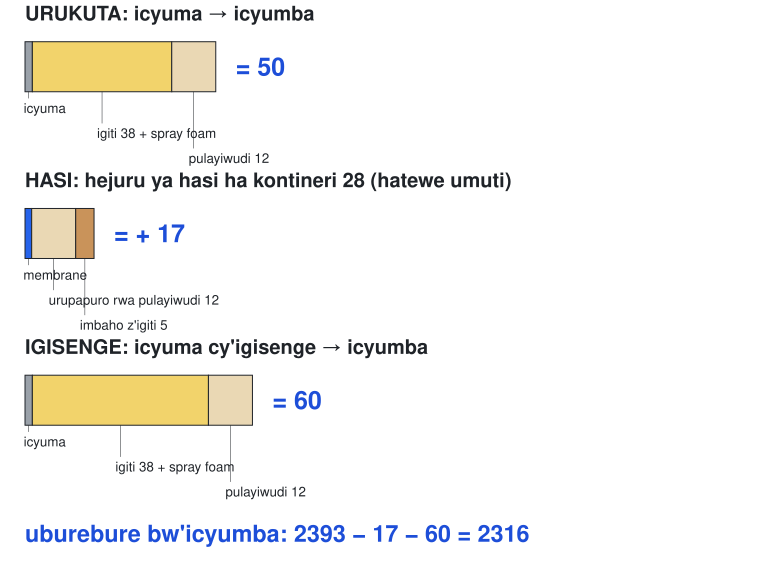
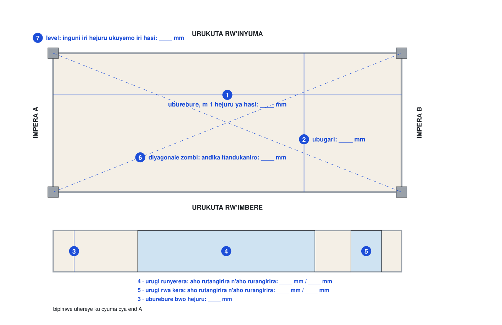
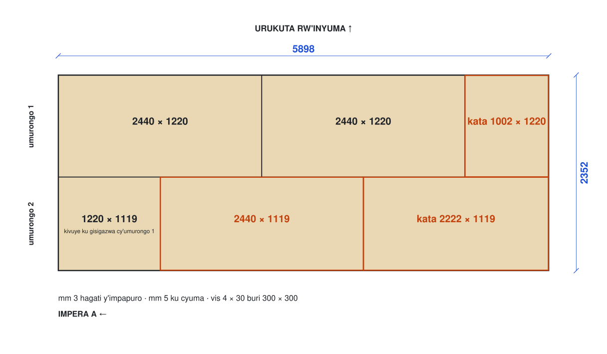
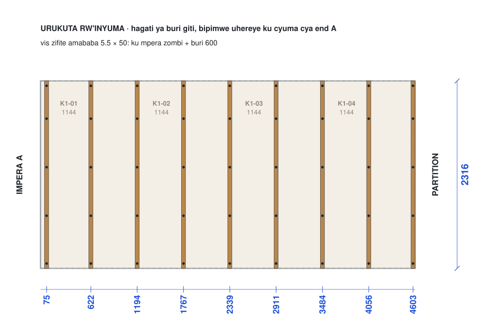
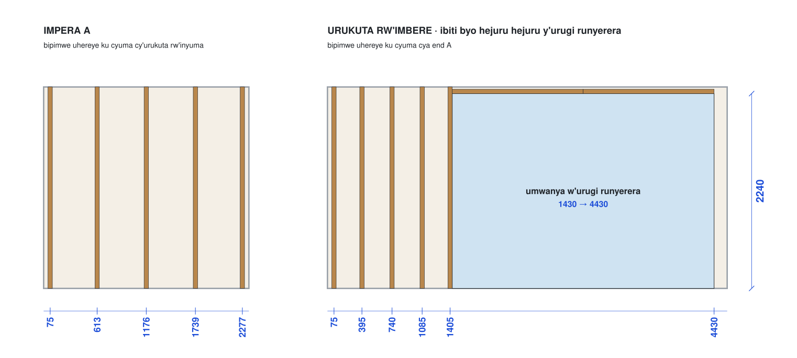
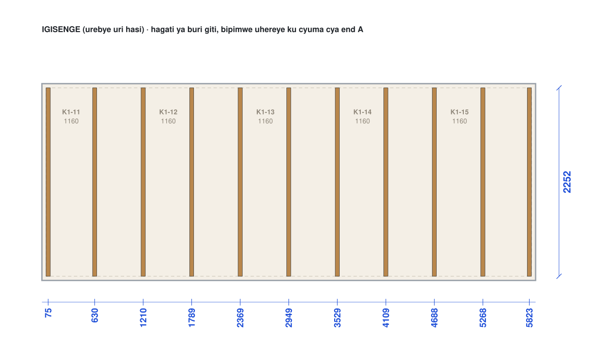
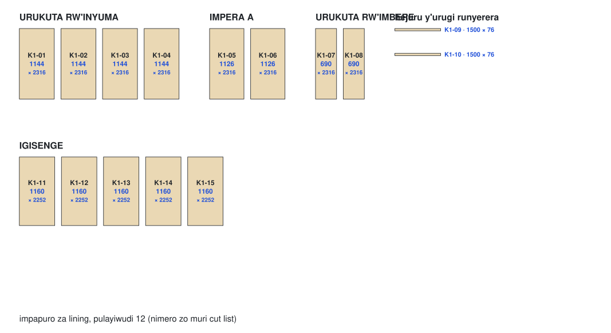
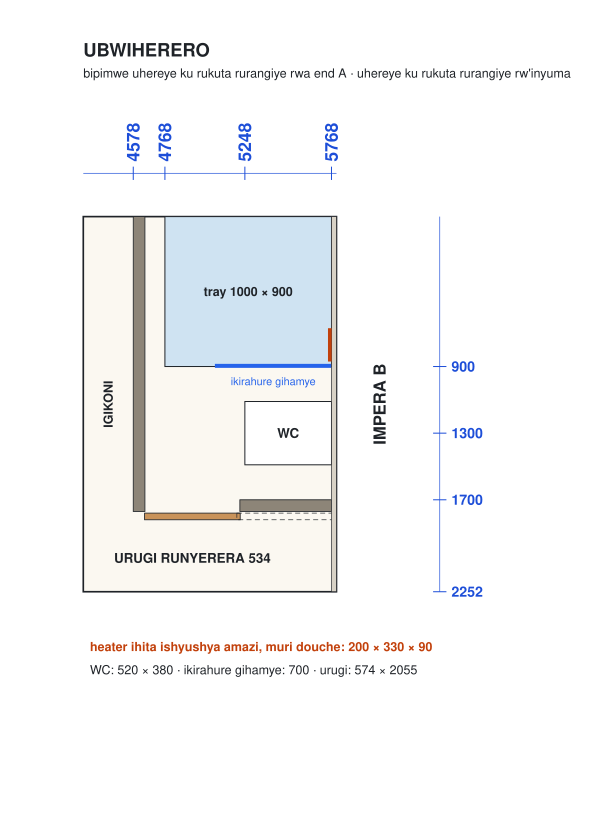
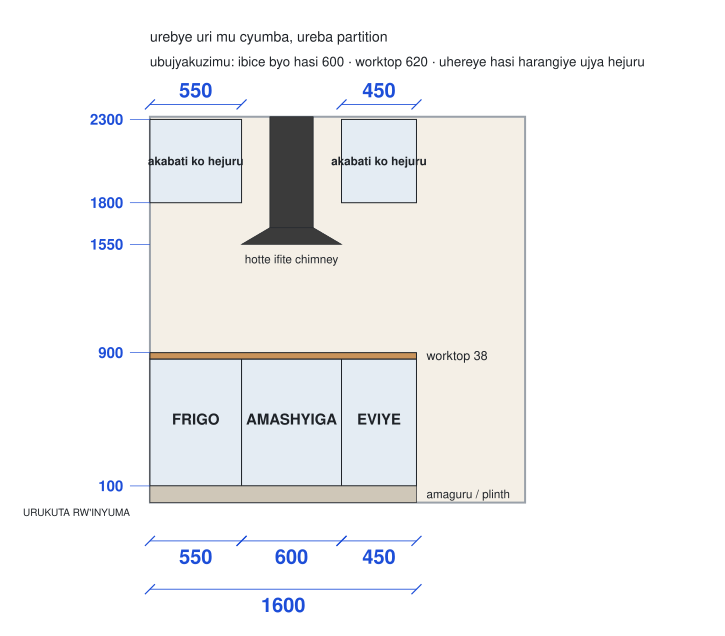

# Sitidiyo: gahunda y'imirimo

> **Ubusobanuro:** iyi nyandiko yahinduwe na mudasobwa (machine draft). Igomba gusuzumwa n'umuntu uvuga Ikinyarwanda kavukire mbere yo kuyiha abakozi. Iyo hari itandukaniro, kurikiza iy'Icyongereza.

Status: verisiyo {{studio.rev}}, {{studio.rev_date}}, {{studio.status}}. Banza upime (Mbere yo gutangira): atelier ntigira icyo ikata mbere ya verisiyo B.

Buri ntambwe yo gutunganya sitidiyo imwe ya kontineri, ku murongo: ibishushanyo by'umubaji biriho ibipimo byabyo muri milimetero, n'intambwe umuyagankuba (electrician) n'umufundi w'amazi (plumber) binjiriramo.

Sitidiyo zombi zirasa, bityo iyi gahunda ikora kuri zombi.

English: [read this plan in English](plan.md) · Gucapa: [iyi gahunda nka PDF](../../public/guides/studio-plan-rw.pdf) · Sitidiyo mu bishushanyo: [urupapuro rwa sitidiyo](/en/studio) · Izindi paji zayo: [ibikoresho](materials.md), [amashanyarazi](electric.md), [imiyoboro y'amazi](plumbing.md)

## Mu ncamake

- Icyumba kirangiye gifite uburebure {{studio.l}}, ubugari {{studio.w}} n'uburebure bwo hejuru {{studio.h}}.
- End A ni impera ifunze, iruhande rw'igitanda; end B ni impera y'ubwiherero.
- Sitidiyo imwe itwara hafi RWF {{studio.unit_rwf_m}}M harimo ibiteganyirijwe ibitunguranye (contingency), utabariyemo imirimo ifamu isangiye ya septic, amazi n'umuriro (hafi RWF {{studio.shared_rwf_m}}M kuri sitidiyo zombi) [A: ibiciro by'agateganyo kugeza habonetse ibiciro bitatu byanditse (quotes) kuri buri murongo, reba [ibikoresho](materials.md)].

[Ibyo sitidiyo ifite](../../src/components/studio/docs-sections.tsx#StudioFeatures)

## Mbere yo gutangira

1. Pima kontineri zombi za sitidiyo; uzandikeho U1 na U2 ku nzugi ukoresheje ingwa (chalk).
2. Andika imibare 7 ku [rupapuro rw'ibipimo](../../study/studio/studio-site.md), wohereze ifoto yarwo uwo munsi.
3. Teganya umusuderi: imirimo yose yo gusudira ikorwa mbere, ibitereko bimaze kuringanizwa (S01).
4. Imirimo ifamu isangiye igomba kuba yiteguye cyangwa iri gukorwa: septic tank, ikigega cy'amazi na pompe yacyo yongera umuvuduko (booster), board yo ku kibanza n'insinga iyigaburira (feeder) ([amazi y'ifamu](../farm/water.md), [amashanyarazi y'ifamu](../farm/electric.md)).
5. Bara buri gipfunyika (bundle) cya sitidiyo kiri ku kibanza mbere y'intambwe ya mbere.

## Intambwe

### Hasi: membrane n'impapuro (S02)

1. Banza urangize gusudira kose (S01): nta gusudira iyo foam imaze gushyirwamo.
2. Shyiraho membrane hejuru ya hasi ha kera, laps mm 150. Ntuzigere ukuba (sand) hasi ha kera.
3. Shyiraho impapuro nk'uko bigaragara mu gishushanyo uzifunge: vis 4 × 30 buri mm 300.

### Ibiti (battens) (S03)

1. Ibiti 38 × 50, bihagaze ku mpapuro za hasi.
2. Shyira akamenyetso hagati ya buri giti uhereye ku cyuma, ku mibare iri mu gishushanyo.
3. Vis zifite amababa 5.5 × 50 ku mpera zombi na buri mm 600.

### Amatiyo n'insinga, hanyuma foam (S04, S05)

1. Umuyagankuba (electrician) n'umufundi w'amazi (plumber) bashyiramo insinga n'amatiyo (S04): [amashanyarazi](electric.md), [imiyoboro y'amazi](plumbing.md).
2. Amatiyo ageragezwa kuri bar 10: tegereza urupapuro rwasinywe.
3. Foam ishyirwa hagati y'ibiti; tegereza amasaha 24, hanyuma uyikate ingane n'ibiti.

### Impapuro za lining (S05)

1. Banza igisenge, hanyuma inkuta.
2. Buri ruhande rw'urupapuro rugwa hagati ku giti.
3. Vis 4 × 30: buri mm 200 ku mpande, buri mm 300 hagati.

### Ubwiherero (S06 kugeza S10)

### Igikoni (S11 kugeza S14)

1. Banza ushyireho imbaho z'igiti (oak planks), uhereye kuri end A kugeza kuri partition.
2. Hanyuma ibice bitatu byo hasi, worktop, akabati ko hejuru na hood.

### Igitanda, intebe na trims (S15 kugeza S18)

- Igitanda, akameza ko ku buriri, ameza n'intebe na trims biva muri atelier nka kits zifite nimero: teranya buri kimwe ukurikije urupapuro rwa kit yacyo.

### Second fix, igisenge na esikariye (S19 kugeza S27)

1. Second fix y'umuyagankuba n'igerageza (S19): [amashanyarazi](electric.md).
2. Fatisha na bolt ibiti binini bya deck (deck beams) ku mfuruka z'icyuma za kontineri (corner castings), hanyuma ufatishe imbaho za deck usiga umwanya wa mm 5 hagati yazo (S20, S21).
3. Fatisha na bolt inkingi z'uruzitiro (guardrail posts), ushyireho igiti gikomeye cyo hejuru (hardwood top rail) kandi ukurure insinga za stainless (S22, S23).
4. Shyiraho inkingi za veranda n'ibirenge bya esikariye; fatisha na bolt ibice bibiri bya esikariye n'aho bahagarara hagati (landing) (S24, S25).
5. Shyiraho intebe n'akameza ko ku ruhande, hanyuma uhuze ibyuma n'ubutaka (earth) (S26, S27).

## Ingingo zo guhagarara ukagenzura (hold points)

1. Ibipimo byoherejwe → verisiyo B → atelier irakata.
2. Gusudira kose kwarangiye → hanyuma foam.
3. Igerageza ry'amatiyo ryatsinze → hanyuma foam.
4. Foam imaze amasaha 24 yuma → hanyuma impapuro.
5. Membrane y'ubwiherero yagenzuwe → hanyuma amakaro.
6. Injeniyeri w'inyubako yagenzuye igisenge → hanyuma abashyitsi bakoresha terase (S27).

## Byarangiye iyo

1. Igerageza ry'amashanyarazi ryatsinze kandi icyemezo (certificate) cyasinywe (S19); amatiyo yagumanye bar 10 mbere ya foam, imiyoboro y'amazi yanduye yageragejwe yuzuzwa amazi, kandi douche igumana hafi 40 °C iyo ifunguye yose.
2. Inzugi, utubati dukururwa (drawers) n'urugi rw'ubwiherero bifunguka neza; urugi runyerera rurafunga; inzitiramibu (insect mesh) irakweze.
3. Septic system y'ifamu yatsinze igenzura ryayo: nta mushyitsi ucumbika mbere yaho (D-016).
4. Buri sitidiyo isukuwe kandi ifotowe, n'ibipimo byayo bibikwa hamwe n'ibishushanyo byayo.

## Ibibazo bitarasubizwa

1. Ni izihe kontineri ebyiri ziba U1 na U2? Umunsi wa 1.
2. Hari umusuderi wateganyijwe? Mbere ya S01.
3. Ni nde uzashyiraho spray foam? Mbere ya S05.
4. Impapuro za hasi mm 12, cyangwa mm 18 niba hasi ha kera hatarangana birenze mm 5 kuri m 2? Mbere ya S02.
