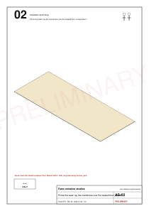
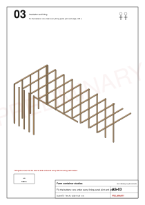
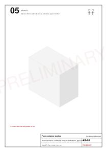
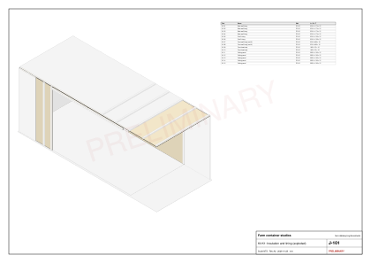

# Carpenter's guide: the studio interior

Status: revision {{studio.rev}}, {{studio.rev_date}}, {{studio.status}}. Sizes come from photos until the Day 1 survey; the workshop cuts nothing before revision B.

Everything the carpenter needs to fit out one 20 ft container as a guest studio, step by step, with every measurement.

The two studios are the same, so one guide serves both.

Kinyarwanda: [soma aya mabwiriza mu Kinyarwanda](carpenter.rw.md) · Print: [this guide as a PDF](../../public/guides/carpenter.pdf)

## Words used here

- **End A**: the closed end wall, by the bed. **End B**: the cargo-door end, by the bathroom.
- **Back wall**: the long wall with no openings (bed and sofa). **Front wall**: the long wall with the sliding glass door and the small window W1.
- **From the steel**: measured from the bare steel, before any lining. **From the finished wall**: measured from the lining face.
- All sizes are millimetres (mm) unless written otherwise.

## The studio at a glance

| What | Size (mm) |
|---|---|
| Container inside, steel to steel | {{studio.int_l}} long, {{studio.int_w}} wide, {{studio.int_h}} high |
| Finished room, lining to lining | {{studio.l}} long, {{studio.w}} wide, {{studio.h}} high ({{studio.area_m2}} m²) |
| Wall build-up | {{studio.lining_wall}}: batten 38 with spray foam between, then plywood 12 |
| Ceiling build-up | {{studio.lining_ceil}} |
| Floor build-up | {{studio.lining_floor}}: plywood sheets 12, then oak planks 5 (bathroom: vinyl) |
| Sliding glass door, from the finished end-A wall | {{studio.slider_x0}} to {{studio.slider_x1}}, head at {{studio.slider_head}} |
| Bathroom partition, from the finished end-A wall | starts at {{studio.part_x0}}, {{studio.part_t}} thick |

| Who | Steps |
|---|---|
| Carpenter, 2 people | S02, S03, S05 (lining), S06, S07, S11 to S18 |
| Welder | S01 (all hot work) |
| Electrician and plumber | S04 (first fix), S19 (second fix) |
| Spray-foam contractor | S05 (foam) |
| Tiler | S08 |

## Five hold points: stop and check

1. **Survey back.** The Day 1 measurements are in and revision B is issued. Until then the workshop cuts nothing; site steps S01 to S03 can go ahead.
2. **Hot work done.** All welding and grinding (S01) is finished before any foam goes in.
3. **Pressure test passed.** The first fix (S04) is tested at 10 bar and the result written down before the foam.
4. **Foam cured.** The foam has cured for 24 hours and is trimmed flush before the first lining panel.
5. **Wet walls checked.** The bathroom membrane is inspected before the tiler starts.

Two rules that never change:

- Never sand, plane or cut into the container floor: it is treated with pesticide. Cover it with the membrane and screw new sheets on top.
- Set out from the steel, as the tables say, and check the finished sizes against this guide.

## Day 1: measure the container

Measure both studio containers before anything else and send the numbers the same day. Mark **U1** and **U2** on their doors with chalk. The third container is the office; it is not measured here.

[Table: Survey sheet, fill the value_mm column](../../study/studio/survey.csv)

1. **int_length**: inside length, steel of end A to steel of end B, 1 m above the floor.
2. **int_width**: inside width, steel to steel, 1 m above the floor, halfway along.
3. **int_height**: floor to roof steel, halfway across.
4. **o1_start** and **o1_end**: where the big opening for the sliding door starts and ends, measured from the steel of end A.
5. **o2_start** and **o2_end**: where the old narrow door starts and ends, from the steel of end A.
6. **diag_diff**: measure both floor diagonals, corner to corner; write the difference.
7. **level_diff**: with a water level, the highest corner casting minus the lowest.
8. Take photos: each wall straight on, the floor, the four corner castings, the sliding-door frame, the old narrow door.

## Order of work

| Step | Work | Who | Hold point |
|---|---|---|---|
| S01 | Survey, level the supports, all welding | Welder and carpenter | 1, 2 |
| S02 | Membrane and floor sheets | Carpenter | |
| S03 | Battens | Carpenter | |
| S04 | First fix: cables, conduits, pipes | Electrician and plumber | 3 |
| S05 | Spray foam, then the lining panels | Sprayer, then carpenter | 4 |
| S06 to S10 | Bathroom: partition, door, wet walls, tray, WC, heater, basin | Carpenter, tiler, plumber | 5 |
| S11 to S14 | Oak planks, then the kitchen | Carpenter | |
| S15 to S17 | Bed, bedside table, seating | Carpenter | |
| S18 | Trims, caulk, paint, insect screens | Carpenter and painter | |
| S19 | Second fix and certificate | Electrician | |
| S20 to S27 | Roof terrace and stair, later | Welder and carpenter | |

## S01: survey, level and all the welding

1. Fill the survey sheet (Day 1 above).
2. Level the four corner castings on concrete pads or steel shims; the corner on the rock needs a pad. Aim for under 5 mm between the highest and lowest corner, and write it in level_diff.
3. Welder: weld the 2 mm steel infill into the old narrow door ({{studio.w1_x0}} to {{studio.w1_x1}} from the finished end-A wall, up to {{studio.w1_sill}} high) and fit the louvre window 520 × 890 above it.
4. Welder: seal and lock the end-B cargo doors, and cut the 75 mm sleeve for the AC in the back wall.
5. From S05 on, no welding or grinding on the container: it would burn the foam.

## S02: membrane and floor sheets

1. Brush rust converter, then zinc primer, on any bare or rusty steel of the walls and ceiling (4 L per studio).
2. Sweep the container floor. Lay the polythene membrane (250 µm) over the whole floor: laps of 150 mm, taped, turned 50 mm up the walls ({{studio.membrane_m2}} m² with the laps).
3. Lay the plywood sheets 12 mm (2440 × 1220), long side along the container, 3 mm gaps between sheets and 5 mm from the steel: {{studio.floor_sheets}} sheets per studio.
4. Run 1, along the back wall: a full sheet, another full sheet, then the last one cut to fit (about 1000 long).
5. Run 2, along the front wall, ripped to the width left (about 1120): start with a half sheet (1220 long, from the run-1 offcut), then a full sheet, then the last one cut to fit (about 2220 long). No joint lines up with a joint in run 1.
6. Screw down with wood screws 4 × 30 (bag F) every 300 mm both ways, about {{studio.floor_screws}} per studio. Use 30 mm screws only, so they stay inside the 28 mm container floor.
7. Check: no step at any joint, and the floor flat within 3 mm under a 2 m straightedge.

## S03: battens

1. Use treated battens 38 × 50, standing on the floor sheets: {{studio.battens}} per studio.
2. Put one batten under every lining-panel joint and one between, so no gap is over 600 mm. Mark each centre from the steel, as the set-out table says.
3. Fix each batten to the steel with winged self-drilling screws 5.5 × 50 (bag L): one at each end and one every 600 mm, {{studio.batten_screws}} per studio.
4. Over the sliding door, fix one horizontal batten along the head at {{studio.slider_head}} (two lengths of 1500).
5. Check: every batten plumb, and all of them in one plane: a straightedge across three battens touches all three.

[Table: Batten set-out, the centre of each batten](../../public/designs/studio/data/battens.csv)

## S04: first fix, by the electrician and the plumber

1. Keep the spaces between the battens clean and dry.
2. Help them mark the boxes and pipe routes from drawings E-101 and P-101 before the cables go in.
3. Do not start S05 until the 10 bar pressure test is written down and signed.

## S05: spray foam, then the lining panels

1. The spray-foam contractor fills between the battens with closed-cell foam, about 38 mm, walls and ceiling: {{studio.foam_m2}} m² per studio. Mask the sliding-door frame, the window and the floor first.
2. After 24 hours, trim the foam flush with the battens.
3. Fix the {{studio.lining_panels}} numbered lining panels (plywood 12, ids K1-01 to K1-15), ceiling first, then the walls. Every panel edge lands on a batten centre.
4. Screw with wood screws 4 × 30 every 200 mm along the edges and every 300 mm across the middle, about {{studio.lining_screws}} per studio.
5. Check each cut-out against its box before fixing the panel; then check that no foam shows and the panel faces are in one plane.

## S06 to S10: the bathroom (kit K2)

1. S06: stand the partition ({{studio.part_t}} thick, at {{studio.part_x0}} from the finished end-A wall) and the cross wall, and fix their skins.
2. S07: fit the door frame and hang the bathroom door (600 wide, opening into the bathroom).
3. S08, the tiler: 12 mm cement board and a waterproof membrane on the wet walls, then tiles 300 × 600 from the floor up; grey safety vinyl in one sheet on the bathroom floor, coved 100 mm up the walls.
4. S09: set the shower tray ({{studio.tray_l}} × {{studio.tray_w}}), its ledge and the fixed glass screen.
5. S10: hang the wall-hung WC, the {{studio.heater_l}} L water-heater box (450 × 450 × 300) on end wall B above the WC, the basin and the mirror cabinet in the wash lobby.

## S11 to S14: oak planks, then the kitchen (kit K3)

1. S11: lay the oak planks ({{studio.plank_m2}} m² with 8% spare) over the living area from end A to the partition: rows along the container, end joints at least 300 mm from the row before.
2. S11, then: stand the fridge bay ({{studio.fridge_w}}), the hob base ({{studio.hob_w}}) and the sink base ({{studio.sink_w}}) on their legs along the partition: one run of {{studio.galley_run}}, {{studio.galley_d}} deep.
3. S12: assemble the overhead cabinet and hang it on the steel rail, two people.
4. S13: scribe and fix the worktop 38 ({{studio.worktop_d}} deep), drop in the sink and the hob, fix the plinth.
5. S14: fix the hood shelf under the overhead cabinet and hang the hood.
6. Check: the walkway from the worktop to the sofa end is at least {{studio.aisle_min}} (designed {{studio.aisle}}).

## S15 to S18: bed, bedside table, seating, trims

1. S15, the bed (kit K4): fix the headboard to the back wall, bolt the frame, screw down the 20 slats, slide in the two storage boxes. The bed runs from end A to {{studio.bed_x1}}.
2. S16, the bedside table (kit K5): glue the leg strips, screw the top and the shelf; it stands at {{studio.bedside_x0}} to {{studio.bedside_x1}}.
3. S17, seating (kit K6): place the sofa ({{studio.sofa_x0}} to {{studio.sofa_x1}}) and slot together the table and the two chairs.
4. S18, trims (kit K7): scribe and pin the trims, caulk, paint off-white satin, fit the insect screens.

## The workshop: cutting the kits

Only after revision B, from the survey.

1. Buy the boards for both studios from one batch. Measure ten sheets: plywood 18 must be 18.0 ± 0.3 mm, or tell the designer before cutting.
2. Rip into strips (± 0.5 mm), then crosscut; mark each part's id on a hidden face at once. Large panels: diagonals equal within 1 mm.
3. Edge-band what the cut list marks: L1 is one long edge, L2S2 is all round.
4. Drill with the templates: print T-01 at 100% and check its 100 mm bar first.
5. Dry-fit studio 1's kitchen and bed in the workshop before packing.
6. Pack one bundle per kit per studio, at most about 25 kg, labelled "Studio n / Kit / bundle x of y".

Per studio: {{studio.parts}} parts, listed in the [cut list](../../public/designs/studio/data/cut-list.csv), with cutting diagrams C-101 to C-107 and the CNC files beside it.

## What to buy, per studio

| Item | Quantity |
|---|---|
| Plywood 12, sheets 2440 × 1220, floor | {{studio.floor_sheets}} |
| Plywood 12, sheets 2440 × 1220, linings | {{studio.sheets_ply12}} |
| Plywood 18, sheets 2440 × 1220 | {{studio.sheets_ply18}} |
| Marine plywood 18, sheets 2440 × 1220 (bathroom) | {{studio.sheets_mply18}} |
| Worktop blank 38, 3050 × 650 | {{studio.sheets_wtop38}} |
| Treated battens 38 × 50, 2.4 m long | {{studio.battens}}, plus 10% spare |
| Polythene membrane 250 µm | {{studio.membrane_m2}} m² |
| Oak planks 5 with underlay | {{studio.plank_m2}} m² |
| Spray foam, by the contractor | {{studio.foam_m2}} m² |
| Winged screws 5.5 × 50 (bag L) | {{studio.batten_screws}} |
| Wood screws 4 × 30 (bag F), floor and linings | {{studio.floor_screws}} + {{studio.lining_screws}} |
| PU foam, 750 ml cans | 12 |
| ABS edge band | 161 m |

The full list with prices is the [bill of materials](../../public/designs/studio/data/bom.csv).

## Before you call it finished

1. Doors and drawers run freely, the bathroom door swings clear, the sliding door locks, the insect mesh is tight.
2. No foam shows, every panel joint sits on a batten, no screw head stands proud.
3. Clear spaces: walkway at the sofa end at least {{studio.aisle_min}}, 600 in front of the WC, 600 at the shower entry.
4. The design itself passes its 33 [checks](../../public/designs/studio/data/checks.csv).

## Questions to answer before the step named

1. Which two containers are U1 and U2? Before Day 1 ends.
2. Is a welder booked for S01? Before Day 1 ends.
3. Who sprays the foam? No spray-foam contractor in Kigali is confirmed yet. Before S05.
4. Floor sheet thickness: 12 mm, unless the survey finds the old floor more than 5 mm out over 2 m; then 18 mm and a new revision. Before S02.

## Drawings

Every other sheet, AS-01 to AS-27 and C-101 to C-107, is in the [drawing list](../../public/designs/studio/data/drawings.csv).
