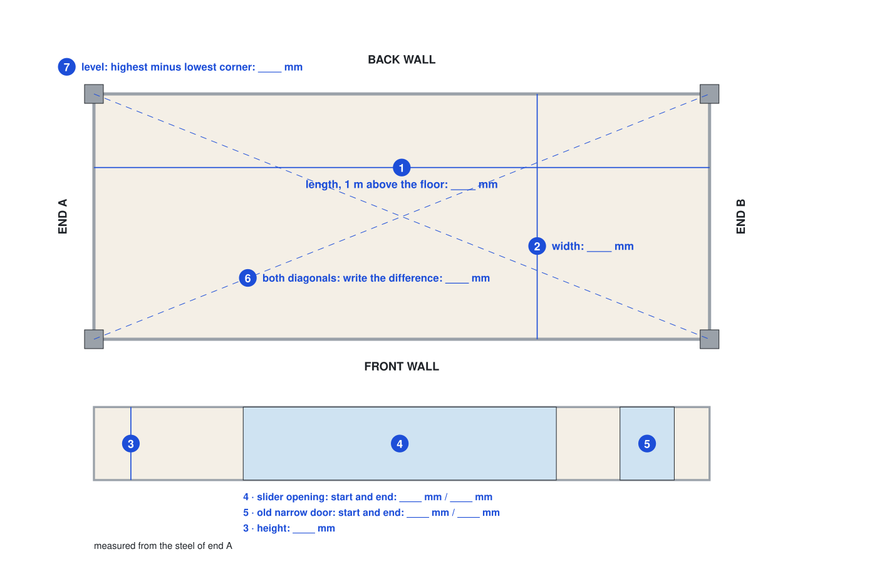
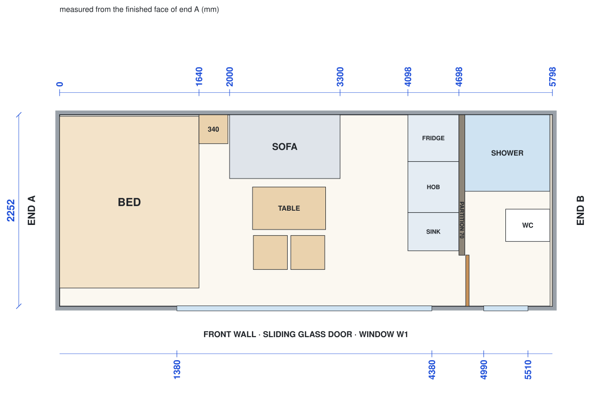
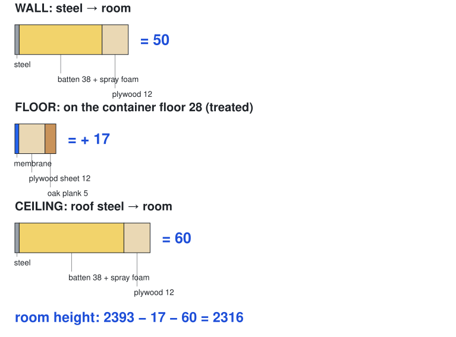
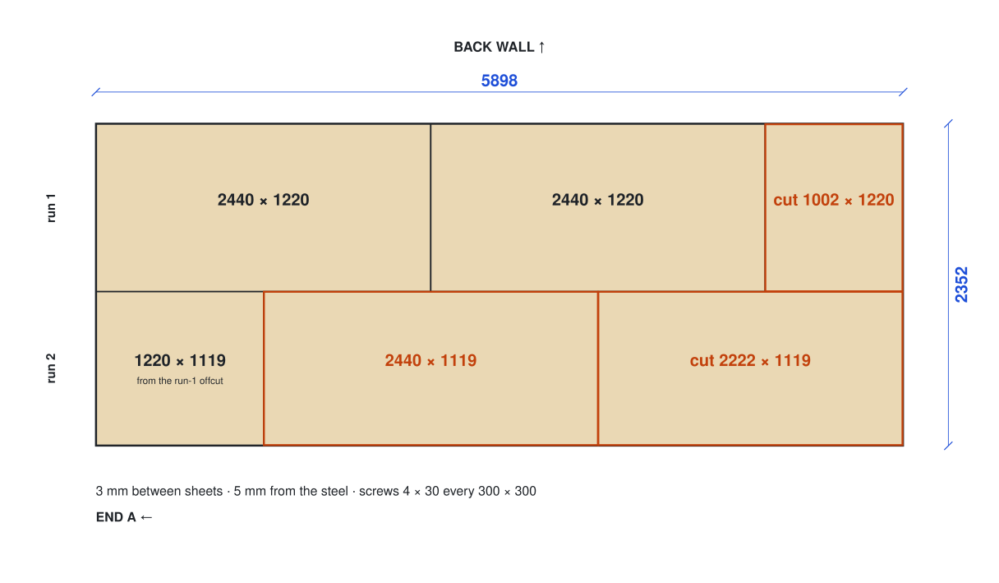
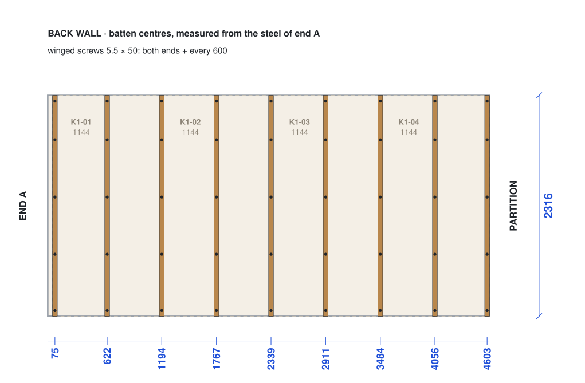
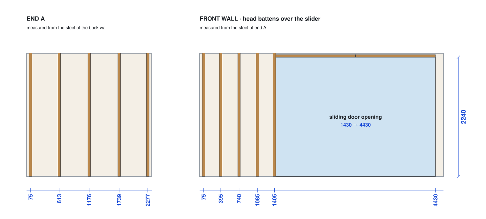
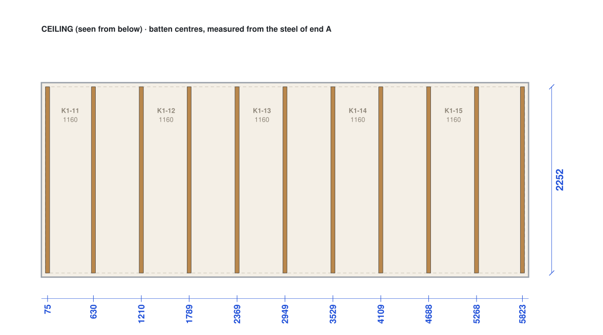
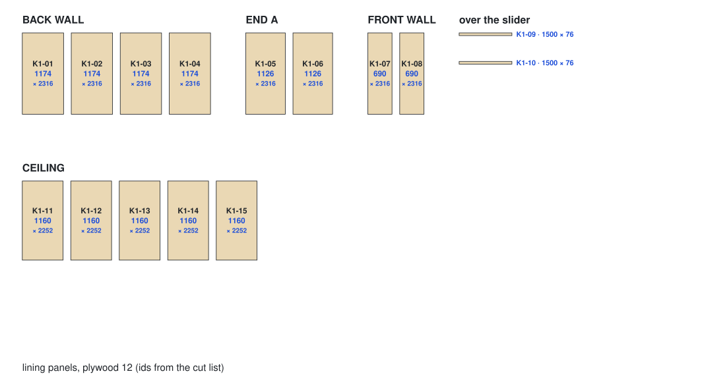
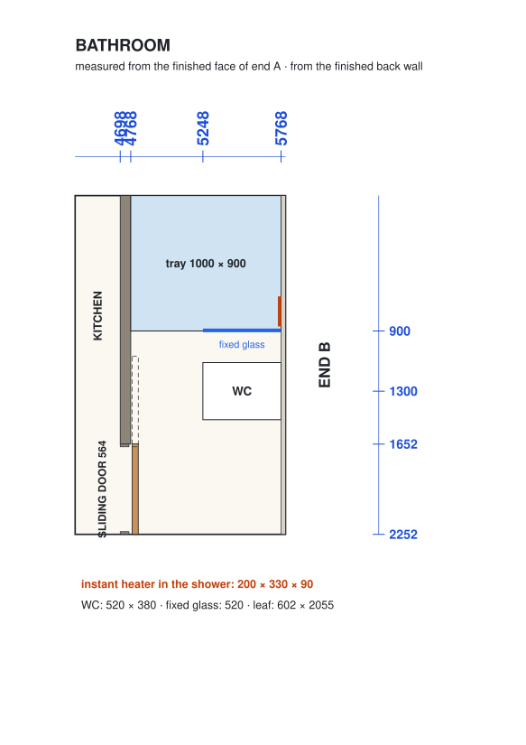
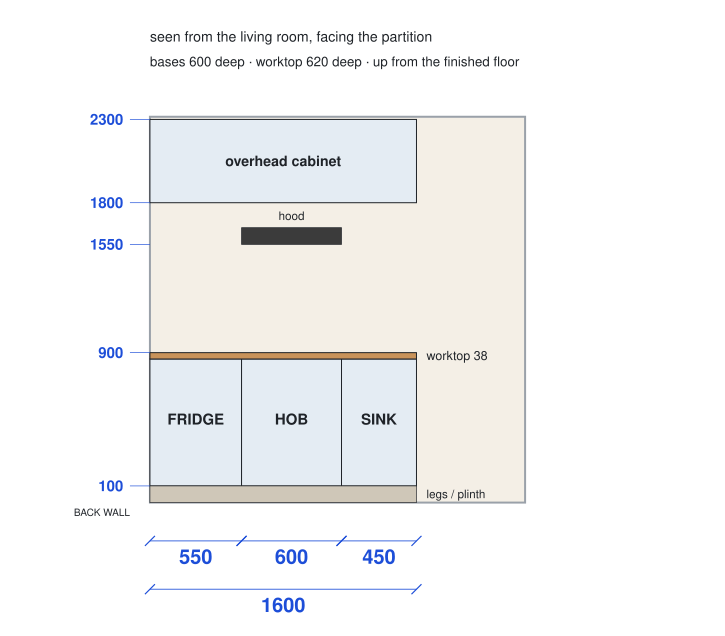

# Carpenter's guide: the studio interior

Status: revision {{studio.rev}}, {{studio.rev_date}}, {{studio.status}}. Measure first (step 1): the workshop cuts nothing before revision B.

Every step of the studio interior as a drawing with its measurements, in millimetres.

The two studios are the same, so one guide serves both.

Kinyarwanda: [soma aya mabwiriza mu Kinyarwanda](carpenter.rw.md) · Print: [this guide as a PDF](../../public/guides/carpenter.pdf)

## 1. Measure the container (Day 1)

1. Measure both studio containers; mark them U1 and U2 on the doors with chalk.
2. Write the 7 numbers and send a photo of the sheet the same day.

## 2. The finished room

- The finished room is {{studio.l}} long, {{studio.w}} wide and {{studio.h}} high.
- End A is the closed end, by the bed; end B is the bathroom end.

## 3. What goes on the steel

## 4. Floor: membrane and sheets (S02)

1. Finish all the welding first (S01): no welding once the foam is in.
2. Lay the membrane over the old floor, laps 150 mm. Never sand the old floor.
3. Lay the sheets as drawn and screw them down: screws 4 × 30 every 300 mm.

## 5. Battens (S03)

1. Battens 38 × 50, standing on the floor sheets.
2. Mark each centre from the steel, at the numbers drawn.
3. Winged screws 5.5 × 50 at both ends and every 600 mm.

## 6. Pipes and cables, then foam (S04, S05)

1. The electrician and the plumber put in their cables and pipes (S04).
2. The pipes are tested at 10 bar: wait for the signed paper.
3. The foam goes in between the battens; wait 24 hours, then cut it flush.

## 7. Lining panels (S05)

1. The ceiling first, then the walls.
2. Every panel edge sits on a batten centre.
3. Screws 4 × 30: every 200 mm on the edges, every 300 mm in the middle.

## 8. Bathroom (S06 to S10)

## 9. Kitchen (S11 to S14)

1. Lay the oak planks first, from end A to the partition.
2. Then the three bases, the worktop, the overhead cabinet and the hood.

## 10. Bed, seating and trims (S15 to S18)

- The bed, the bedside table, the table and chairs and the trims come from the workshop as numbered kits: build each one from its kit sheet.

## 11. Stop and check

1. The measurements are sent → revision B → the workshop cuts.
2. All the welding is done → then the foam.
3. The pipe test has passed → then the foam.
4. The foam has cured for 24 hours → then the panels.
5. The bathroom membrane is checked → then the tiles.

## 12. What to buy, per studio

| Item | Quantity |
|---|---|
| Plywood 12, sheets 2440 × 1220, floor | {{studio.floor_sheets}} |
| Plywood 12, sheets 2440 × 1220, linings | {{studio.sheets_ply12}} |
| Plywood 18, sheets 2440 × 1220 | {{studio.sheets_ply18}} |
| Marine plywood 18, sheets 2440 × 1220 (bathroom) | {{studio.sheets_mply18}} |
| Worktop blank 38, 3050 × 650 | {{studio.sheets_wtop38}} |
| Treated battens 38 × 50, 2.4 m long | {{studio.battens}}, plus 10% spare |
| Polythene membrane 250 µm | {{studio.membrane_m2}} m² |
| Oak planks 5 with underlay | {{studio.plank_m2}} m² |
| Spray foam, by the contractor | {{studio.foam_m2}} m² |
| Winged screws 5.5 × 50 | {{studio.batten_screws}} |
| Wood screws 4 × 30, floor and linings | {{studio.floor_screws}} + {{studio.lining_screws}} |
| Concrete block stands 40 × 60 cm | 4 |

The full list with prices is the [bill of materials](../../public/designs/studio/data/bom.csv); every part's size is in the [cut list](../../public/designs/studio/data/cut-list.csv).

## 13. Questions before the step named

1. Which two containers are U1 and U2? Day 1.
2. Is a welder booked? Before S01.
3. Who sprays the foam? Before S05.
4. Floor sheets 12 mm, or 18 mm if the old floor is more than 5 mm out over 2 m? Before S02.
