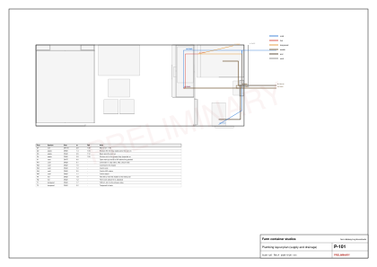
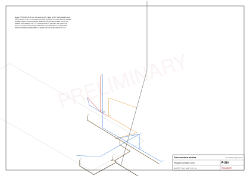
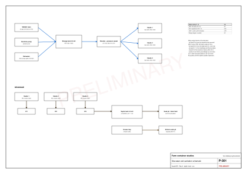

# Plumber's guide: the studio

Status: revision {{studio.rev}}, {{studio.rev_date}}, {{studio.status}}. No guest stays before the septic system passes its inspection (D-016).

Everything the plumber needs for one container studio: supply, hot water, drains, the tests, and what the studio needs from the farm.

The two studios are piped the same, so one guide serves both.

Kinyarwanda: [soma aya mabwiriza mu Kinyarwanda](plumber.rw.md) · Print: [this guide as a PDF](../../public/guides/plumber.pdf)

## Words used here

- **End A**: the closed end wall, by the bed. **End B**: the cargo-door end, by the bathroom.
- **Back wall**: the long wall with no openings. **Front wall**: the long wall with the sliding glass door.
- Positions in the fittings table are millimetres from the finished end-A wall (x), from the finished back wall (y) and up from the finished floor (z).

## The studio at a glance

| What | Design |
|---|---|
| Supply pipe | PPR PN20, 25 mm for the main, 20 mm inside |
| Main in | under the floor at end B, up into the sink base: stop valve, Y-filter, check meter (SV) |
| Hot water | a {{studio.heater_l}} L box, 2 kW, IPX4, on end wall B above the WC; stored at 60 °C |
| Mixing valve (TMV) | behind a tiled access panel in end wall B, between the shower and the WC; 41 to 44 °C to the shower and the basin |
| Drains | WC 110 mm, shower 50 mm, basin 40 mm, kitchen sink 50 mm on its own line to a grease trap; all at 1:40 or steeper |
| Vent | 75 mm open vent up end B, ending 900 mm above the roof guardrail |
| Shower tray | {{studio.tray_l}} × {{studio.tray_w}} |
| Pressure | 2.5 to 3 bar from the farm's booster pump |

| When | What | Step |
|---|---|---|
| After the battens (S03) | First fix: main in, every supply and drain run, the 10 bar test | S04 |
| With the bathroom | Tray (S09), WC, heater and basin (S10) | S09, S10 |
| With the kitchen | Sink, tap and filter | S13 |

## Three hold points

1. **Battens first.** Start the first fix only when the battens (S03) are fixed and the floor sheets are down.
2. **The 10 bar test.** Fill the PPR, hold 10 bar for one hour with no drop, write it down and sign it before the spray foam (S05). The foam buries the pipes.
3. **Before guests.** The drains are fill-tested, the vent smoke-tested, the TMV measured at the shower, and the farm's septic system inspected.

## S04: first fix

1. Bring the cold main (W1, 25 mm) in under the floor at end B and up into the sink base through the stop valve, Y-filter and check meter, where it can be shut off without tools.
2. Run the cold inside the units and the walls: through the partition, the back wall's lining and end wall B to the WC cistern (W4), the basin (W5) and up to the heater (W2). Keep cold 300 mm above the floor.
3. Run the hot (60 °C) down from the heater to the mixing valve (H1) and back along the same walls to the sink (H2, labelled hot). Keep hot 360 mm above the floor.
4. From the mixing valve, take the two tempered runs (T1 to the shower valve, T2 to the basin): each about 1.2 m, under the 2 m allowed for a mixed-water dead leg.
5. Every run goes straight: along the wall, then straight up to its outlet. No diagonal legs.
6. Hang the drains in the void under the floor (the container stands about 700 mm up): WC 110 mm, shower 50 mm, basin 40 mm to the inspection chamber; the kitchen sink 50 mm on its own line to the grease trap. Pass between the 122 mm cross-members, never through them.
7. Fall at 1:40 or steeper; rodding eyes at every bend; the 75 mm vent up end B.
8. Pressure-test at 10 bar for one hour, photograph every wall, sign the release for the foam.

[Table: Pipe runs: system, size, length and fall](../../public/designs/studio/data/pipes.csv)

[Table: Fittings: what, where and how high](../../public/designs/studio/data/fittings.csv)

## S09, S10 and S13: second fix

1. S09: set the shower tray ({{studio.tray_l}} × {{studio.tray_w}}) on its 90 mm waste, with the carpenter's ledge and the fixed glass screen.
2. S10: hang the wall-hung WC on its slim concealed cistern (80 mm frame in end wall B, 30 mm build-out, dual-flush plate).
3. S10: hang the {{studio.heater_l}} L heater box (450 × 450 × 300) above the WC; pipe its temperature-and-pressure relief valve outside.
4. S10: fit the basin (400 × 300) and its mixer with a bottle trap in the wash lobby; the thermostatic shower valve, head and rail on end wall B.
5. S13: the kitchen mixer tap on angle valves, and the drinking-water filter in the sink base with its own faucet by the tap.

## Tests

1. PPR at 10 bar for one hour, before the foam (S04).
2. Fill-test every drain and check every trap holds its seal.
3. Smoke-test the vent.
4. Measure the mixed water at the shower with a thermometer: 41 to 44 °C.
5. Run a hot shower, then time the heater: about 40 minutes to heat up again.

## What the studio needs from the farm

- One cold supply at 2.5 to 3 bar from the farm's storage tank and booster pump. Mains water enters that tank through an air gap, so private water never flows back into the main (D-016).
- A soil connection from the inspection chamber outside end B to the farm's septic tank, and the kitchen line to a grease trap with its own soak pit.
- The septic tank sits at least 50 m from the borehole, 3 to 7 m from buildings and the boundary, downhill of the borehole, within 30 m of tanker access, and only after a percolation test.

[Table: Site water and septic sizing for the two studios](../../public/designs/studio/data/site-water.csv)

## Drawings

