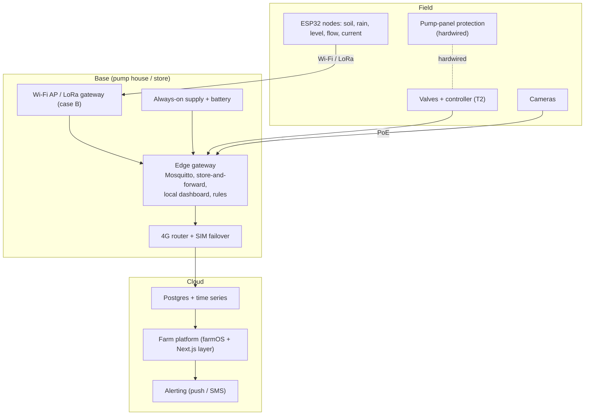

# IoT architecture — connectivity, hardware, monitoring, security, offline operation

Status: Stage 5 draft · Date: 2026-10-19 · Location: **unconfirmed** — terrain, signal and farm size are unknown, so the recommendations are by case.
Labels: `[V]` `[E]` `[A]` `[U]` (`CLAUDE.md`); `ENG-nn` in `../registers/incoming/eng-sources.csv`.

## 1. Principles

1. **Start with the lowest complexity that gives reliable visibility** (brief, Part VIII-D): few nodes, one gateway, one uplink.
2. **Measure only what changes a decision** (section 5). Every sensor has an owner, a decision and a retire date.
3. **Local first.** Irrigation logic, alarms and logging run on the farm. The cloud displays, reports and configures.
4. **Protection is not software.** Hardwired protection stays in the pump panel (`irrigation-automation.md`).
5. **Use the right grade for the job:** hobby-grade boards for non-critical sensing, industrial hardware where environment, safety or reliability justify it (section 4).
6. **Founder-maintainable.** Open protocols (MQTT, Modbus), open firmware, replaceable parts; documented well enough that a local technician can swap a node.

## 2. Connectivity options compared

Figures marked `[A]` are typical values to be confirmed with datasheets and a site survey.

| | Wi-Fi (2.4 GHz) | Cellular (4G; LTE-M/NB-IoT `[U]` in Rwanda) | LoRaWAN | LoRa point-to-point | Ethernet / PoE |
|---|---|---|---|---|---|
| Role | Short-range link to nodes and cameras near the base | Backhaul to the internet; also direct to remote nodes | Low-rate sensor network over kilometres | Simple link between two or three devices | Fixed wiring for cameras, gateway, pump house |
| Typical outdoor range `[A]` | 50–150 m per access point; trees and metal cut it | National network | 2–5 km line of sight in farmland, less in dense trees or hills | Similar to LoRaWAN | 100 m per cable run (more with a switch) |
| Data rate | High | High | Low (bytes per message) | Low | High |
| Node power | High (tens of mA when active); fine if mains or a good panel supplies it | Moderate to high per message; module ≈ USD 10–20 `[A]` | Very low; years on a battery possible `[A]` | Very low | Mains-class (PoE supplies power) |
| Infrastructure | Access points (powered) | None, but a SIM per site or node | A gateway on the farm (self-hosted network server) or a public one; coverage by third parties not assumed | None | Cable, trenching, surge protection |
| Running cost | None | SIM data (placeholder RWF 15,000 a month for one router `[A]`) | None for a private gateway | None | None |
| Standardisation | Mature | Mature | LoRaWAN is an open standard | Proprietary; each project invents its own | Mature |
| **Rwanda status** | 2.4 GHz is a short-range device band [D ENG-17] | MTN reports 94.8% population 4G coverage [C ENG-03]; ministry about 97% [D ENG-04]; **area coverage at a lakeside farm is `[U]`**; Starlink is a costly fallback (about RWF 572,000–581,000 plus RWF 48,000–65,000 a month [D ENG-13]) | **Legal band, power and duty cycle not confirmed:** RURA's SRD guidelines require type approval and list 433 MHz and 2.4 GHz [C ENG-07]; 863–870 MHz was not verified [U] | Same band question | n/a |
| Main risk | Range and power at the field edge; interference | Coverage gaps; outage during storms; SIM management | Regulation and type approval; gateway placement | No ecosystem; hard to support | Cable damage, lightning on long runs |
| Fit for 2–10 ha | Good for compact farms | Essential as the uplink | Worth it only when nodes are > 150 m from the base | Only for one remote link | Good for pump house and cameras |

## 3. Recommendation by farm size and terrain

| Case | Architecture |
|---|---|
| **A. Up to about 5 ha, compact, gentle slope, cellular signal at the base** (most likely case) | One 4G router with a SIM failover at the base. One or two weatherproof Wi-Fi access points (powered from the pump house or the base) cover the nodes. Field nodes use Wi-Fi with deep sleep. Wired Ethernet/PoE only for cameras and the gateway. No LoRa. |
| **B. 5–10 ha, or nodes more than about 150 m from a powered point, or hills and tree cover** | Same uplink. Add a small LoRaWAN gateway at a high point and move remote nodes to LoRaWAN, **after** the band and type approval are confirmed [C ENG-07]. Use Wi-Fi near the base. |
| **C. Cellular weak or absent at the base** | Test the best signal on the site first (an elevated external antenna often fixes it). If still weak, either a roof-mounted outdoor 4G antenna with a router, a second operator SIM, or as a last resort a satellite terminal. The edge system works without the internet, so the shortfall affects only alerts (section 8). |
| **D. Farm split by a road, stream or the lake buffer** | A separate local network per cluster joined by cellular, rather than one long radio link. |

**Rule `[A]`:** do a cellular signal survey of both networks at the gate, the pump house and the highest point before buying any radio hardware. Cost is a phone and a day. Terrain and signal are `[U]` until the pin exists.

## 4. Hardware choices

### 4.1 Where each class belongs

| Class | Use for | Do not use for |
|---|---|---|
| **ESP32 boards** (Espressif; module about USD 5 [B ENG-15]; choose a current variant, because the part seen is "not for new designs") | Field nodes (soil, rain, level), pump-current monitoring, sensor-to-MQTT bridges, the T2 valve controller with a proper relay/driver board in an enclosure | Anything where a hang or reboot could cause harm without a hardwired stop; wide-temperature panel work |
| **Raspberry Pi-class or small x86 edge gateway** | MQTT broker, store-and-forward database, rules, local dashboard, NVR if small | Directly switching pumps or valves; use an SSD or industrial storage, not a bare SD card `[A]` |
| **Industrial PLC** | Pump-house panel when there is a VFD or a three-phase motor, a safety interlock requirement, wide temperature/EMC conditions, or a contractor will maintain it | The first farm kit; costs RWF 1.1–2.7M [E] and needs separate skills |
| **Industrial sensors** (4–20 mA, RS-485 or SDI-12) | Tank level, pressure and flow at the pump, soil probes where long cables and lightning exposure make hobby grade unreliable | Every small node |
| **Hobby-grade sensors** (capacitive moisture, DS18B20, DHT-class) | Pilot measurements; replace when drift shows | Critical measurements without a redundant check |
| **Hardwired relays and switches** | Dry-run, overload, float low-level, overpressure | Replacing with software logic |

Industrial hardware is justified by **harsh or exposed conditions, a safety function, a lifetime of 10+ years, or a need for technical support**; not by prestige. At 2–10 ha the justified items are the pump-panel protection relays, one pressure/level transmitter at the pump, and the edge gateway storage.

### 4.2 Protocols

- **MQTT** between nodes, gateway and cloud: small messages, last-will for dead nodes, retained state, a local broker (Mosquitto) so everything works offline. Topic scheme `farm/<site>/<zone>/<device>/<measurement>`; payload JSON with a timestamp and units; QoS 1 for data, retained topics for configuration. TLS and per-device credentials from the start.
- **Modbus RTU (RS-485)** for solar controllers, energy meters, VFDs and industrial transmitters; one polling service on the gateway converts to MQTT.
- **SDI-12** only if a chosen soil probe needs it.
- **No proprietary clouds for core control.** A vendor cloud may mirror data, but the farm must run without it.

### 4.3 Node design rules `[A]`

1. Each field node has a watchdog, brown-out reset, a calibrated sensor identity, a firmware version in every message, and over-the-air update that the founder can roll back.
2. Power: node-level solar cell, lithium battery and a charge controller; report battery voltage.
3. Cable discipline: short sensor cable runs, screened, with a surge arrester where entering a building (`electrical-system.md` section 5).
4. Configuration in a signed file, not hard-coded; one node type for all rain/level duties to keep spares simple.

## 5. Environmental monitoring: only measurements that change decisions

| Measurement | Decision it changes | Verdict |
|---|---|---|
| Rain | Skip irrigation; log seasonal totals; evidence for spraying and harvest timing | **Yes** (T0 manual, T1 logged) |
| Soil moisture (20 and 50 cm, wetted zone) | When and how much to irrigate; detects ineffective irrigation | **Yes** in orchard and nursery zones; calibrate each probe [B ENG-09]; avocado benefit unproven [B ENG-10], so keep a control block |
| Tank level | Block irrigation, protect pump, livestock reserve | **Yes** |
| Water flow and volume | Leaks, blockages, permit headroom, cost per m³ | **Yes** |
| Pump current / power | Dry run, wear, restart count | **Yes** |
| Air temperature and humidity | Disease-risk alerts (passion fruit, foliar), cool-store logging | **Defer** — one logger on the gateway node; rain and soil carry more value |
| Wind | Spray timing, trellis damage | **Defer** — not needed until a spray programme or tall trellis exists |
| Solar radiation | Evapotranspiration modelling | **Defer** — use temperature-based ET from published data; revisit for an ET controller |
| Water quality (EC, turbidity, pH) | Drip clogging, livestock suitability, nutrient plan | **Lab test per season**; continuous probes only with fertigation (T3) |
| Soil EC | Salinity management and fertigation | **Defer** until salinity is shown in the soil tests |
| Soil temperature | Planting and germination timing | **Defer** |
| Lake level or flood line | Compliance with 50 m / 200 m buffers [V LOC-02] | **Survey, not sensor** — a one-time site measurement with a dated photograph and flood marks |

Each retained sensor must have a written decision, a calibration interval and a replacement trigger in the maintenance plan.

## 6. Livestock monitoring: start simple

Goats are the more likely species in the eastern zones [V LOC-24]; worms (Haemonchus) are the top health problem [V LVS-10]. An RVF quarantine covers the Eastern Province [V LVS-03], so livestock purchase is gated.

| Need | Start with | Upgrade when |
|---|---|---|
| Identification | Numbered visible ear tags and a register (phone form or farmOS animal asset) | Herd > about 100, or a buyer needs individual traceability: then EID tags (assumed USD 1–2 each, reader USD 150–400 `[A]`) |
| Weights | Weigh-band at purchase and monthly for kids; a platform scale with load cells (RWF 1M–2M `[A]`) when the herd justifies | Growth-rate disputes with buyers or a breeding programme |
| Breeding records | Register fields: dam, sire, service date, birth date, litter size, birth weight | Software import from farmOS |
| Health records | Dated entry per event: signs, who examined, diagnosis by a vet, treatment given by or on the vet's order, withdrawal period, outcome | None; **the system records and reminds; it does not prescribe** |
| Grazing allocation | Paddock rotation calendar; plot map in the platform | Visual forage measurement (e.g., plate meter) once pastures exist |
| Feed inventory | Count of bags and bales at the store | Load-cell weighing of the feed store only if losses are shown |
| Water consumption | A flow meter on the trough line | Trough sensors in T3 |
| Movement and escape | Fence, night housing, gate latch with a contact sensor, a night check | Cameras at gates; GPS collars only after a proven escape/theft problem |
| Mortality and incidents | A short form (date, animal, suspected cause, photo, action) reviewed weekly | Pattern analysis in reports |

Goat housing must sit at least 200 m from the lake bank [V LOC-02]; any equipment is placed with that line on the base map (`../discovery/zoning-concept.md`).

## 7. Security: perimeter, cameras, alerts and privacy

| Layer | Measures | Cost class |
|---|---|---|
| Perimeter | Live fence on the boundary (Z4), lockable gates, signage | Part of the fencing cost |
| Lighting | Photocell LED lights at gate, store, animal house, pump house | Low; powered on the always-on circuit |
| Gate monitoring | Contact or PIR at gate, camera on the access road | Low |
| Equipment protection | Lockable pump house; panel locks; tamper switch; hidden spare key; marked tools | Low |
| Cameras | Two cameras at T1: gate/road and store/animal house. Local recorder on the gateway; motion alert to the phone | RWF 0.27–0.66M for two cameras and a switch [E] |
| Livestock theft | Night housing, tag register, headcount at dusk and dawn, a worker or guard dog `[A]` | Labour, not hardware |
| Alerts | Phone push for gate motion at night, pump house door, power loss, tank empty; local siren for critical events | Software |
| Power | The security loads sit on the always-on circuit with battery backup (`electrical-system.md`) | |

### Privacy and legal notes

- Rwanda's personal-data law (Law 058/2021) applies to identifiable people on video: lawful purpose, transparency, controller registration, protection impact assessment and breach notice duties, with fines of RWF 2–5M [C ENG-08]. Whether a small farm's CCTV needs registration is `[U]`; **ask the National Cyber Security Authority before recording workers or visitors**.
- Practices `[A]`: point cameras at farm assets, not at neighbours' land, the lake path or public roads; put a notice at the gate; tell workers in writing; no audio; keep footage 14–30 days then overwrite; store locally (data stay in Rwanda by default [C ENG-08]); limit access to the founder and manager, and log views.
- The cloud mirrors **alerts and thumbnails only**, not continuous video, unless a legal basis is documented.

## 8. Offline operation

Essential farm processes that must run without the internet and without the cloud:

| Process | How it runs offline |
|---|---|
| Irrigation schedule and interlocks | On the controller (state machine, `irrigation-automation.md`), settings stored locally |
| Local alarms | Siren and light on the farm for critical faults |
| Alert delivery | SMS through the cellular modem when only the data link fails; local siren if both fail |
| Data logging | Gateway stores 30 days of telemetry and events (SSD), uploads when the link returns; no duplicates by message id |
| Time | RTC with battery; NTP when online; tolerate drift of a few minutes |
| Records entry | Offline-capable phone app (installable web app) with a local queue, or a paper form entered later; each record carries its own timestamp and author |
| Dashboard | A local dashboard on the farm network from the gateway |
| Updates | Staged: nothing changes remotely during a cycle; rollback file kept locally |

Design tests (fault injection) are in `commissioning-plan.md` for communications loss, restart and power loss.

## 9. Architecture summary

## 10. Gaps

1. Cellular area coverage on both networks at the site `[U]`.
2. RURA's permitted band, power and duty cycle for LoRa/LoRaWAN, and type-approval of devices [C ENG-07].
3. CCTV registration and guidance from the National Cyber Security Authority [C ENG-08].
4. Rwandan supply and quotes for every hardware line (T12); the only catalogue price seen is the ESP32 module [B ENG-15].
5. Choice of soil probe after the soil test and a bench calibration.
