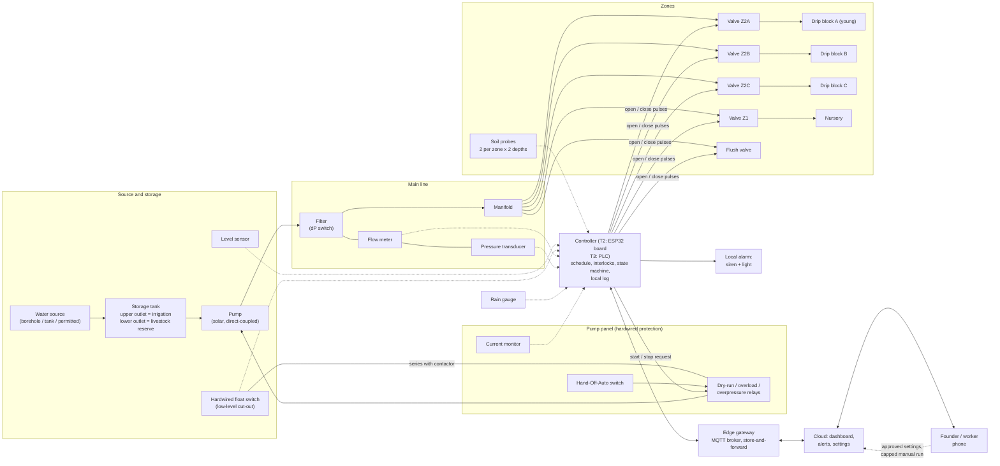

# Irrigation automation — block diagram, control logic and fault responses

Status: Stage 5 draft · Date: 2026-10-19 · Location: **unconfirmed**
Labels: `[V]` `[E]` `[A]` `[U]` as in `CLAUDE.md`. All thresholds are `[A]` starting values to be set at commissioning from measured baselines. No ratings or settings are final (`electrical-system.md` section 0).

## 1. Scope and tier mapping

The same system is built up in steps (see `technology-strategy.md`):

| Tier | What exists |
|---|---|
| T0 | Pump with hardwired protection, tank, hand valves, two mechanical meters, rain gauge, hand probe. A person decides and acts. |
| T1 | Adds logged soil moisture, tank level, flow, pump current, rain; alerts. **Still no automatic valve or pump action** beyond the hardwired protection. |
| T2 | Adds latching valves per zone and a controller that runs the schedule and applies the logic below. Hand-Off-Auto switch and hand bypass valves stay. |
| T3 | Adds an industrial PLC, VFD and fertigation. The logic below is the same; only the platform changes. |

Water-source legal status is unconfirmed. Irrigation over 1 ha, and any pump in a lake, needs a water permit [V LOC-04]. **The design never assumes lake abstraction.** Source options (rainwater and tank, borehole, permitted surface water) are compared in the water-system document once the site is known.

## 2. Block diagram

Solid boxes are present from T0/T1; the "Controller" and "Valves" blocks arrive at T2. Dashed links are information; solid links carry water or power.



Design rules shown in the diagram:

1. **Protection is hardwired in the pump panel.** The controller can request a start; it cannot defeat the float switch, overload, dry-run or overpressure relays.
2. **The edge controller decides; the cloud only configures and displays.** Irrigation continues with the internet down.
3. **Two outlets on the tank.** Irrigation draws from the upper outlet; the lower outlet feeds the livestock troughs by gravity. When the tank falls to the upper outlet, irrigation stops and the animals still have a reserve of water (reserve volume set in design from herd demand `[U]`).
4. **Sequential zones.** The pump serves one zone at a time (hydraulic limit `[A]`), so zone flow is a clean signature for abnormal-flow detection.

## 3. Sensors, valves and zones

### Zones `[A]` (replace with the surveyed layout)

| Zone | Content | Why separate |
|---|---|---|
| Z2A | Orchard block A, young trees (first 2 years) | Smallest root volume; most vulnerable to drying |
| Z2B | Orchard block B, second crop or planting date | Different water demand |
| Z2C | Orchard block C, passion fruit or mango | Different schedule and trellis wetting |
| Z1 | Nursery and trial beds | Daily water, small volume |
| Flush | Line end, filter backwash, main purge | Drains sediment and air |
| Troughs (Z3) | Gravity-fed, hand valves, **not under controller** | Animal water must never depend on electronics |

### Sensor schedule

| Measurement | Device | Location | Purpose | Failure sign |
|---|---|---|---|---|
| Soil moisture (VWC or tension) | Capacitive probe or Watermark-type, per-sensor calibration [B ENG-09] | Two points per zone at 20 cm and 50 cm, in the wetted zone beside an emitter; one control zone with schedule-only watering | Start/stop decision, ineffective-irrigation alert | Flat line, out of range, step jump |
| Rain | Tipping-bucket gauge | Open ground, away from trees | Skip logic, season totals | No tips while probes rise |
| Tank level | Pressure or ultrasonic sensor plus hardwired float switch | Tank | Block start, dry-run guard, volume balance | Reading out of range; disagrees with the float switch |
| Flow | Pulse flow meter | Main line after the filter | Zone signature, leak detection, volume cap | Zero with pump current; pulses with all valves closed |
| Pressure | Transducer | After the filter, and at the head of the last zone | Clogged filter, burst, dry run | Out of range |
| Pump current / power | CT or power monitor | Pump panel | Dry run, blockage, bearing wear, restart count | Reading with pump off |
| Filter differential pressure | dP switch | Across the filter | Blocked-filter alert | |
| Valve position | Latching valve with feedback or inferred from flow change | Each valve | Stuck valve | No flow change after a command |
| Enclosure | Temperature, leak | Panel | Heat and ingress | |

Sensors are only installed where the reading changes a decision (`iot-architecture.md` section 5).

### Valve and actuator choice `[A]`

- **Latching DC solenoid valves** (pulse to open, pulse to close): negligible hold power, hold position through a power loss, and run from a small solar supply. Risk: a valve can be left open when power fails; the restart procedure in section 5 closes all valves into a known state.
- Normally closed 24 V AC/DC valves fail closed on power loss, which is safer for water waste but needs a continuous supply. Selected at design for each zone; mixed use is not recommended.
- Hand-operated bypass or isolating valve at each zone so the farm can irrigate with the controller removed.

## 4. Control logic

### 4.1 Daily decision (per zone), evaluated once in the irrigation window (default 05:30–09:00 `[A]`)

Inputs: validated zone moisture M (median of valid probes), rain in the last 24 h R, tank level T, zone daily volume cap Vcap, the week's baseline volume B for the zone's growth stage, season, and control-zone status.

```
if mode != AUTO                       -> do nothing (hand / maintenance)
if fault latched                      -> do nothing
if R >= R_skip (8 mm)                 -> SKIP (rain)
if M valid and M >= M_upper           -> SKIP (wet)
if T < T_min                          -> SKIP (low tank), alert
if M valid and M <= M_lower           -> run to target: volume Vt = min(B x f, Vcap)
if M valid and M_lower < M < M_upper  -> run B x 0.6 (maintenance) once if days_since_last >= 2
if M invalid                          -> degraded schedule: B x 0.7, alert 'sensor fault'
```

- M_lower and M_upper are per zone and per soil, set from the soil test and the probe calibration (RMSE 4.5–4.9% after calibration, sensor spread up to 16% [B ENG-09]). Start from agronomist advice; do not copy numbers from other crops. The avocado sensor benefit is unproven [B ENG-10].
- Volume is the stopping rule, not time: the zone runs until the flow meter has delivered Vt, or the timeout (150% of Vt at baseline flow) expires, whichever is first.
- Forecast data from the internet may only **defer** a start by one day and only if M is above a critical floor. It never cancels a start in a dry spell.
- The control zone is irrigated by schedule only, so that any yield or water difference from the sensors is measured, not assumed.

### 4.2 State table

| State | Entry actions | Leaves when | Next state |
|---|---|---|---|
| BOOT | Read stored settings; close all valves (pulse each); set pump request off; run self-test (sensors readable, clock valid, flow = 0) | Self-test passes | IDLE |
| | | Self-test fails | DEGRADED or FAULT_LATCHED (by severity) |
| IDLE | Log sensors every 5 min; hold all closed | Window opens; mode AUTO | EVALUATE |
| | | HOA = Hand or remote manual command | MANUAL |
| EVALUATE | Apply section 4.1 per zone, in priority order (youngest first) | Zone needs water | PRESTART_CHECK |
| | | No zone needs water | IDLE (log 'skip' with reason) |
| PRESTART_CHECK | Verify tank level, pressure = 0, flow = 0 with valves closed, battery above threshold, starts-per-hour below limit | All pass | VALVE_OPEN |
| | | Any fails | SKIP (with alert) or FAULT_LATCHED (flow with valves closed) |
| VALVE_OPEN | Open the zone valve; confirm position (flow change expected after pump) | Valve opened (or timeout 20 s) | PUMP_START |
| | | Open command fails twice | FAULT_LATCHED (stuck valve) |
| PUMP_START | Request pump start; ramp for 30 s `[A]` | Current and flow inside window | RUNNING |
| | | No flow after 45 s or current out of window | PUMP_STOP then FAULT_LATCHED (pump / dry run), after one retry |
| RUNNING (zone n) | Integrate volume; compare flow and pressure with the commissioned baseline; watch tank level and battery | Volume delivered | PUMP_STOP |
| | | Abnormal flow, pressure, level, current | PUMP_STOP then FAULT_LATCHED |
| | | HOA moved to Off or remote 'stop' | PUMP_STOP then MANUAL |
| PUMP_STOP | Drop the start request; wait for flow to decay (10 s) | Flow = 0 | VALVE_CLOSE |
| VALVE_CLOSE | Close the zone valve (pulse); verify flow stays 0 | Closed | next zone → PRESTART_CHECK; or FLUSH; or IDLE |
| | | Flow persists | FAULT_LATCHED (valve not closing) |
| FLUSH | Weekly or after a filter alarm: open flush valve for a set time, then close | Done | IDLE |
| DEGRADED | Run the time-based schedule at reduced volume (B × 0.7) with extra alerts | Fault cleared | IDLE |
| FAULT_LATCHED | All valves closed; pump request off; siren and alert sent | Human reset after inspection, logged with reason | BOOT |
| MANUAL | Automatic actions disabled; log manual runs and durations; alert if left on Hand for over 24 h | Switch to Auto or timeout of remote command (max run 60 min `[A]`) | BOOT |

Faults latch and need a **human reset** (the reset itself is a logged action with a reason); only recoverable warnings clear automatically.

### 4.3 Protection layers

| Layer | Acts on | Example | Depends on software |
|---|---|---|---|
| 1. Hardwired | Pump contactor | Float switch low-level, overload, dry-run relay, overpressure switch, HOA | No |
| 2. Controller interlocks | Start permission | Level, battery, starts-per-hour, flow with valves closed | Yes |
| 3. Anomaly detection | Alerts | Flow versus zone baseline, ineffective irrigation, daily volume | Yes |
| 4. Human review | Settings, resets, unusual runs | Approvals in the dashboard | Yes |

## 5. Responses to defined conditions

| Condition | Detection | Automatic response | Alert | Safe fallback | Recovery |
|---|---|---|---|---|---|
| **Low soil moisture** | Zone M ≤ M_lower at evaluation | Run to target volume, capped by Vcap and the weekly cap; sequence youngest first | Info if routine. Warning if two cycles do not raise M by the expected amount ('ineffective irrigation': blocked emitters, probe off the wetted zone, leak) | Never exceed Vcap; no extra 'emergency' run without human approval | Inspect zone; change settings through the approval flow |
| **Rain** | Gauge ≥ R_skip in 24 h | Skip; hold 24 h or until M falls below the lower threshold | Info only | If gauge reads zero while probes rise, flag the gauge, trust the probes | Clean gauge; log the failure |
| **Empty storage** | Float switch opens (hardwired) or level < T_min | Pump cannot start or stops immediately; irrigation blocked; all valves close | Critical: 'tank empty'; includes estimated hours of livestock reserve | Livestock reserve stays via the lower outlet; no emergency draw on any unpermitted source | Refill or source repair; reset after the level rises above T_restart |
| **Abnormal flow, high** | Flow above 130% of the zone baseline for 30 s `[A]` | Stop pump, close valve, latch fault | Critical: 'possible burst or open line' with zone, volume lost | Valves closed; main isolating valve on site is the manual last resort | Find and repair; re-baseline flow if the layout changed |
| **Abnormal flow, low** | Flow below 60% of baseline for 2 min, or dP switch active | Stop zone; flush on next window if dP | Warning: 'filter or emitter clogging, valve partly closed, air lock' | Do not raise pressure to compensate | Clean filter or flush; reset |
| **Flow with all valves closed** | Any flow for 10 min when no cycle is running | Stop pump request; keep valves closed | Critical: 'leak or stuck valve' | Fault latch | Inspect |
| **Daily volume exceeded** | Integrated volume > weekly cap or Vcap | Stop; skip remaining zones | Warning | Water-use limit protects the tank and any permit | Review settings |
| **Pump failure** | Current out of window, no flow with current, thermal trip, more than 3 starts in an hour | One retry after 5 minutes of cooling; second failure latches | Critical: 'pump fault' with current trace | Valves closed; **manual hand watering** of young trees by schedule until repaired (T0 procedure) | Repair; start 'restart' test sheet before returning to Auto |
| **Sensor failure** | Missing > 30 min, out of range, stuck for > 6 h `[A]`, disagree with a redundant sensor | Mark invalid; use the other probe, else the zone median of valid ones, else DEGRADED schedule (B × 0.7, volume capped) | Warning; critical if tank level and float disagree | Bias toward under-use with a cap, because a stuck 'dry' reading would otherwise over-irrigate | Replace or recalibrate; record on the maintenance log |
| **Power failure** | Supply loss, brown-out flag, battery low | Pump stops (it depends on PV or mains); valves hold last state (latching); controller keeps running from its battery if possible | Critical (from the battery-backed alarm) 'power lost', Warning on return | On restart: BOOT closes all valves, tests, **does not resume the interrupted cycle**; a random delay of 30–120 s `[A]` before any pump start | Log owed volume; make up at most 1.5 × the daily cap over the next 2 days |
| **Battery low (controller)** | Battery < 40% warning, < 20% critical | Shed non-essential loads (cameras, lights) per the shedding order; at critical run no new cycles | Warning, Critical | Keep alarm transmitter and the controller alive last | Charge; check PV |
| **Loss of connectivity** | No broker heartbeat for 15 min | Continue the schedule and logic; buffer 30 days of data; local siren and light for critical faults | Alert is queued; sent when the link returns; an SMS path if the cellular modem is up but internet is down | Remote settings frozen; the last approved setting set keeps running | Reconnect; reconcile logs and clock |
| **Controller restart / watchdog** | Watchdog or power-on reset | BOOT as above (valves closed first) | Info 'controller restarted' with cause | No cycle resumes from memory | Review the log |
| **Clock invalid** | Real-time-clock lost | Do not start scheduled runs; allow manual and alarm only | Warning | | Set time (NTP or manual) |

## 6. Manual override and manual operation

1. **Hand-Off-Auto switch** at the pump panel: Hand runs the pump through the hardwired protections only; Off blocks all starts; Auto accepts controller requests. The controller reads the switch and reports it.
2. **Hand bypass valves** on each zone and the tank outlets. A trained worker can irrigate with every electronic device removed. The T0 hand-irrigation schedule is posted on the panel door.
3. **Remote manual run** from the dashboard is allowed only for the founder, capped at 60 minutes per command, rate-limited to a set number a day, logged, and subject to every interlock above. The assistant can propose but never trigger it (`software-architecture.md` section 6).
4. Leaving the switch on Hand sends an alert after 24 hours; manual runs are included in the daily volume.
5. Livestock water has no electronic dependency by design.

## 7. Parameters to be set at commissioning

| Parameter | Starting value `[A]` | Set from |
|---|---|---|
| Irrigation window | 05:30–09:00 | Heat, labour, tank refill |
| R_skip | 8 mm in 24 h | Rain gauge records and the agronomist |
| M_lower, M_upper | Per zone | Soil test, probe calibration, agronomist |
| Zone baseline flow and pressure | Measured on day 1 | Commissioning functional test |
| Tolerance high / low | +30% / −40% | Variance in the first 30 cycles |
| Vcap per zone | Crop water balance, permit | Water balance, permit |
| Pump retry | 1 after 5 min | Pump datasheet |
| Max starts per hour | 3 | Pump and contactor datasheets |
| T_min, T_restart | Livestock reserve + margin, +10 cm | Tank design |
| Sensor-stuck limit | 6 h | Observed noise |

## 8. What to measure to prove the logic is working

| Metric | Target `[A]` | Source |
|---|---|---|
| Missed scheduled irrigations | < 1 a month | Controller log |
| Time from fault to alert | < 5 minutes | Alert log |
| Unplanned water volume | < 5% of total | Flow meters |
| Water per tree per season, control versus sensor zones | Reported, no assumed benefit | Meters; harvest records |
| False alarms | < 2 a week | Alert log |
| Manual interventions | Recorded and trending down | Audit log |

Results feed Gate E2 in `technology-strategy.md` and the sensor-benefit claim.
