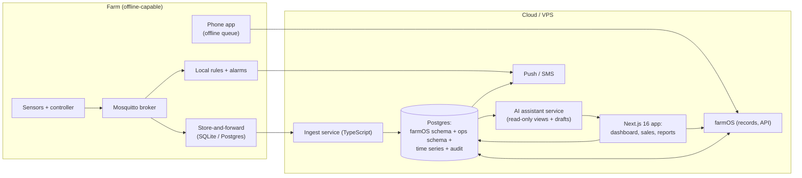

# Software architecture — farm management platform and AI assistant

Status: Stage 5 draft · Date: 2026-10-19 · Location: **unconfirmed** · Stack constraint: Next.js 16, React 19, Prisma, Postgres, TypeScript
Labels: `[V]` `[E]` `[A]` `[U]` (`CLAUDE.md`); `ENG-nn` in `../registers/incoming/eng-sources.csv`.

## 1. The answer

1. **Do not build a platform yet.** The brief says so ("do not build a large custom platform before validating the farm's operating processes") and the model agrees (software line RWF 1.5M in M3, with no modelled benefit).
2. **Adopt first.** Run records on forms and a spreadsheet until the site and processes exist (Phase 0); then adopt **farmOS** (self-hosted, open source, API) for assets and logs (Phase 1), pending a hands-on check. LiteFarm is the alternative to test in the same two-week bake-off.
3. **Build only the gaps**, in the founder's stack, as a thin Next.js layer: telemetry and alerts, a dashboard, sales/customers/cash flow, and the forecast-versus-actual report (Phases 2–3).
4. **The AI assistant is read-only plus drafts** (Phase 4). It observes, flags, summarises and drafts; humans decide. It has no write path to equipment, medication or money.

## 2. Requirements (from the brief, Part VIII-H)

Farm maps and zones · crop and tree inventories · planting records · irrigation · soil and weather data · livestock records · veterinary events · feed · labour and tasks · equipment maintenance · inventory · harvest · sales · expenses · cash flow · supplier management · customer relationships · alerts · reports · user permissions · audit logs.

Non-functional `[A]`: works offline on a phone (records are entered in the field); English first, Kinyarwanda/French labels later; RWF with the BNR rate stored per transaction; every record has who/when/where; data exportable in open formats at any time; no vendor lock-in; backups tested.

## 3. Build versus adopt

Real open-source candidates, what was verified, and what was not:

| Candidate | What it is | Fit to the requirements | Stack fit | Evidence quality |
|---|---|---|---|---|
| **farmOS** | Drupal-based, GPL, self-hostable farm record-keeping; asset entities (plantings, animals, equipment) and logs (activities, observations, inputs, harvests); sensor/data-stream support; REST/OpenAPI/OAuth2 API; digital public good [B ENG-05] | Strong on zones/land assets, plantings, animals, logs, harvest, inputs; sensors supported but data volume limits exist (an old commit capped API data at 100,000 points `[U]`); finance, CRM and cash flow are thin `[U]` | PHP/Drupal, not our stack; runs in containers; we integrate through the API and build the UI in Next.js if needed | Registry page and a search summary only. The docs site refused connection on 2026-10-19; current version, modules and sensor limits **must be checked on farmos.org** |
| **LiteFarm** | Free GPLv3 web app from UBC Farm for farm management and sustainability research; JavaScript; community-driven [B ENG-06] | Crop and field management, finances and sustainability reporting are its stated focus `[A]`; livestock/animal support, offline use and RWF handling `[U]` | JavaScript/TypeScript, closer to our skills `[A]` | UBC page and search summary only; the GitHub URL tried returned 404 (the organisation is LiteFarmOrg). Needs a hands-on trial |
| **Custom build** (Next.js 16, Prisma, Postgres) | Our own | Exactly our fields, Arabic/Kinyarwanda UI, our reports | Perfect | Highest cost: the founder's time is the real cost |
| Others not researched `[U]` | ERPNext/Frappe (has an agriculture module), Odoo, KoBoToolbox or ODK (field forms), spreadsheets | Not evaluated; ERPNext and KoBoToolbox are worth a 1-day look | | **No evidence collected** |

### Recommendation

1. **Phase 0 forms and spreadsheets** are the default for the first months (see section 4).
2. **farmOS for records** if the bake-off confirms: zones, plantings, animal assets, logs, harvest, inputs, equipment maintenance, user roles. Reasons: open source, the data model already matches farm objects, an API, self-hosting, a large community [B ENG-05]. Cost: PHP/Drupal skills for plugins; we avoid that by building extensions outside it.
3. **Custom layer** for what farmOS and LiteFarm lack: telemetry, alert rules, the dashboard, sales/customers/suppliers/expenses, cash flow, and model-vs-actual reports.
4. **Bake-off scorecard** (2 days, farmOS demo vs LiteFarm demo vs a spreadsheet): fit to the requirements in section 2 (0–2 each), offline field entry, API quality, roles and audit, export, time to enter 10 typical records, maintenance burden, language. Record the decision in `../execution/decision-log.md`.

The decision can be reversed cheaply because records are exportable and the custom layer talks to a thin interface.

## 4. Phased plan

| Phase | When (gate) | What | Build effort `[A]` | Exit criteria |
|---|---|---|---|---|
| **0 Validate processes** | Now → site confirmed; keep running through Stage 4 and first season | Paper log books and one shared spreadsheet with fixed columns: activity log, water log, planting register, animal register, feed/inventory, sales, expenses, supplier/customer sheets; weekly review. Photo of every receipt | 0 days build | 8–12 weeks of logs; the team uses the same columns without help; list of 10 queries the founder actually asked |
| **1 Adopt records** | After Gate E1 and the bake-off | Self-host farmOS (container on a small VPS, nightly backup tested); import the Phase 0 data; field entry on phones; roles | 3–5 days setup `[A]` | Records are complete (>90% of activities logged within 24 h); backup restored once |
| **2 Telemetry and alerts** | When T1 sensors run | MQTT subscriber (TypeScript) → Postgres time-series tables; alert rules (tank, flow, pump, battery, heartbeat); push/SMS; read-only dashboard in Next.js using farmOS for context | 8–12 days `[A]` | 4 weeks of data; false alarms < 2 a week; heartbeat alarm tested (`commissioning-plan.md`) |
| **3 Fill the gaps** | After one season of records | Sales, customers, suppliers, expenses, cash flow; forecast-vs-actual against the financial model; harvest-to-sale traceability; weekly report | 15–25 days `[A]` | Each module replaces a spreadsheet that took > 2 h a week; adoption by the manager |
| **4 AI assistant** | After 3 months of clean data | Read-only assistant with drafts and an inbox for approvals (section 6) | 10–15 days `[A]` | Evaluation set passed; reviewed for one month in shadow mode |
| **5 Scale or sell** | Only if the farm grows or the tool is reusable | Multi-farm, public docs, packaging | | Out of scope now |

**Rule for building any module:** a process must have been run by hand for at least 8 weeks, in the same way by the same people, with stable fields; and the monthly cost of doing it by hand must exceed the build and upkeep cost.

## 5. Proposed architecture



Choices `[A]`:

- **Postgres 16+** with Prisma 6/7 for the custom schema; time-series in plain partitioned tables or TimescaleDB if the volume demands it (a few thousand readings a day is small). Raw telemetry beyond 90 days is aggregated.
- **Next.js 16 App Router, React 19, server actions with Zod validation**, shadcn/ui, RTL-ready. Auth.js with roles. Mirror pattern from the founder's other products where it fits.
- **farmOS stays the system of record for farm objects**, so we do not rebuild assets/logs. The custom app reads and writes it through its API.
- **Hosting:** a small VPS or managed container for farmOS; managed Postgres. Personal data (workers, customers) must be stored in Rwanda or covered by a registration certificate for transfer [C ENG-08], so region choice is a legal item `[U]`. Farm-only telemetry has no such limit.
- **Offline:** a local broker and buffer at the farm; the phone app is an installable web app with a queue.
- **Security:** least-privilege API tokens, TLS, backups (daily, restore tested quarterly), secrets outside code, per-user accounts, no shared logins.

### Roles and permissions

| Role | Can do | Cannot do |
|---|---|---|
| Owner (founder) | Everything, approvals, settings, resets | |
| Manager | Tasks, records, inventory, purchase approval up to a limit `[A]`, review alerts | Change irrigation limits, delete audit |
| Worker | Enter activity, harvest, animal and task records; see their tasks | See finance; edit others' entries |
| Vet / agronomist (external) | Add notes and instructions on named animals/blocks | Edit other records |
| Accountant | Read finance; export | Operational edits |
| Assistant (service account) | Read scoped views, create **drafts** in an inbox | Write to records, devices, payments or messages outside the inbox |

**Audit log:** append-only table of actor, time, entity, before/after, reason, source (web/phone/API/assistant). Every manual irrigation, reset, setting change and approval appears in it.

## 6. Draft data model (entities)

Single farm now; a `farm_id` is on every table so the model can host more later at little cost.

| Group | Entities and main fields |
|---|---|
| Core | `Farm`, `User` (role, language), `Role`, `AuditLog` (append-only), `Attachment` (photos, receipts), `Setting`, `Unit` |
| Land | `Zone` (code, type Z0–Z5, geometry, area_ha, notes), `Block` (zone, species, planting date, status), `WaterPoint` (type, permit id, flow), `Structure` (house, store, animal house, tank), `Boundary` / `Buffer` (legal setback type and distance) |
| Plants | `Species`, `Cultivar`, `Planting` (block, count, date, source, supplier, cost), `TreeGroup` / `Tree` (id, block, row, position, graft date), `PlantEvent` (pruning, replanting, disease note), `Harvest` (block, date, qty, grade, destination), `Nursery` batch |
| Water | `IrrigationZone` (block links, valves), `Valve`, `FlowMeter`, `Tank`, `IrrigationEvent` (zone, start, volume, source: auto/manual, reason), `WaterBalance` (period, in, out) |
| Telemetry | `Device` (type, firmware, last seen), `Sensor` (device, unit, calibration), `Reading` (sensor, time, value, quality flag), `Calibration`, `Alert` (rule, severity, state, ack by), `AlertRule` |
| Weather & soil | `RainLog`, `SoilTest` (zone, date, lab, results), `WaterTest`, `WeatherDaily` |
| Livestock | `Animal` (tag, species, breed, sex, dam, sire, birth date, source, status), `Herd/Paddock`, `Weight` (animal, date, kg), `Breeding` (service, kidding, litter), `HealthEvent` (animal, date, signs, vet, diagnosis by vet, treatment instruction by vet, withdrawal end), `Mortality`, `Movement`, `Incident` |
| Feed | `FeedItem`, `FeedStock` (qty, location), `FeedUse`, `ForageMeasure` |
| Operations | `Task` (assignee, due, source: manual/assistant, status), `Worker`, `Timesheet`, `Equipment`, `MaintenanceTask`, `MaintenanceLog`, `Input` (fertiliser, pesticide, with withdrawal period) |
| Inventory | `Item`, `StockMovement`, `ReorderRule` |
| Commercial | `Supplier` (contact, products, price observations, verified flag), `Customer` / `BuyerLead` (status: prospect / customer), `PurchaseRequest` (draft → approved), `PurchaseOrder`, `Sale` (customer, product, qty, price, price type), `Invoice`, `Payment`, `Expense` (category, line, receipt), `CashPosition`, `Budget/Forecast line` (from the financial model) |
| Reports | `Report` (period, generated, approver), `Summary` (daily/weekly, kind: observation/prediction/recommendation), `Inbox` (assistant drafts awaiting a decision) |

Rule: the evidence labels from the study carry into the system (`label V/E/A/U` on price and supplier observations, with a source field), so the platform keeps the same discipline.

Illustrative Prisma fragment (not final):

```prisma
model AssistantDraft {
  id          String   @id @default(cuid())
  farmId      String
  kind        DraftKind        // OBSERVATION | PREDICTION | RECOMMENDATION
  title       String
  body        String
  evidence    Json             // [{ table, id, field, value }]
  confidence  Float?           // only for predictions
  expiresAt   DateTime
  action      DraftAction      // NONE | CREATE_TASK | PURCHASE_REQUEST | REPORT
  status      DraftStatus      // PENDING | ACCEPTED | REJECTED | EXPIRED
  decidedById String?
  decidedAt   DateTime?
  createdAt   DateTime @default(now())
}
```

## 7. AI assistant design

### 7.1 Purpose and boundaries

The assistant reads farm records and telemetry through scoped, read-only views, writes **drafts** into the inbox, and never touches equipment, animals or money. It must separate three kinds of statements and label each:

| Kind | Meaning | Required content |
|---|---|---|
| **Observation** | A fact in the records or telemetry | Source record ids, time, unit |
| **Prediction** | A statement about the future or an unmeasured state | Method, inputs, a range, a confidence note, an expiry time |
| **Recommendation** | A suggested human action | The observation(s) it rests on, the owner, the consequence, an approval class |

An answer without evidence is not shown. "I do not have a record for that" is a valid answer.

### 7.2 Capabilities, inputs and guardrails

| Capability | Inputs | Output | Guardrails |
|---|---|---|---|
| Summarise daily farm activity | Logs, tasks, harvest, sales, alerts of the day | Observation summary with links | Quote records; no invented events |
| Identify missing records | Expected-record rules (e.g., a watering logged but no worker entry; weights not taken for 30 days) | List of gaps and who should fill them | Reminders only; never fabricates the missing entry |
| Flag abnormal water use | Flow vs zone baseline, daily volume, tank trend, rain | Observation (what deviated, by how much) and a prediction of likely causes with a range | Cannot start, stop or reconfigure irrigation; flags to a person (`irrigation-automation.md`) |
| Highlight possible crop stress | Soil moisture trend, days since irrigation, weather, photos supplied by workers | "Possible stress in block B, check emitters and leaves" with evidence | A flag, not a diagnosis; photo interpretation is advisory and must be confirmed by a human or agronomist |
| Track animal health events | `HealthEvent` records, weights, mortality | Timeline per animal; clusters (e.g., 3 animals with the same signs in 7 days) as an observation; due dates already recorded (vaccination, withdrawal end) | **No diagnosis, dose, drug or treatment advice.** Clusters go to the vet with the records. The assistant never says "treat" |
| Recommend tasks for review | Gaps, alerts, schedule, maintenance intervals | Draft tasks | Human accepts or rejects; one click creates the task, never assigns it automatically to a worker without the manager |
| Summarise weather risks | Weather data and forecast (advisory); rain log | Observation (what happened), prediction (what is forecast, with source and time) | Never cancels or defers irrigation by itself |
| Prepare purchase requests | Stock below reorder level, supplier register, last prices | Draft `PurchaseRequest` with item, quantity, supplier options, last price, label V/E | Draft only. **No message or order is sent to a supplier** (`CLAUDE.md` no-outreach rule); manager approves |
| Generate management reports | All of the above | Weekly/monthly report | Figures traceable to queries; numbers recomputed by SQL, not by the model |
| Compare actual with forecast | `Forecast line` (from the financial model) versus actuals | Variance table; prediction of year-end with range | States the model's assumptions are `[A]`; no forecast is called a fact |

### 7.3 Approval classes and prohibitions

| Class | Examples | Rule |
|---|---|---|
| A0 Information | Summaries, charts, reports | Shown to everyone with a role; no approval |
| A1 Low-consequence drafts | Create a task, add a reminder | Accepted by the manager or owner |
| A2 Consequential | Purchase request, change a report recipient, mark a record as verified | Owner or manager approval, logged with a reason |
| A3 **Not available to the assistant** | Start/stop a pump or valve, change any irrigation limit, change protection or electrical settings, prescribe or administer veterinary medication, diagnose animals, delete or edit records, send messages to suppliers/buyers/officials, make payments, accept contracts | Blocked at the API: the assistant's service account has no endpoint for these, and the prompt also forbids them |

Humans carry out A3 actions after reading the observation. Pump or valve actions go through the controller's own override path and its logs.

### 7.4 Technical controls

1. **Least privilege:** read-only database views; the only write is `AssistantDraft`. No shell, no network tools beyond the model API and the farm API.
2. **Structured output** with a schema validator: kind, evidence ids that must resolve to real rows, confidence (predictions only), expiry. A draft failing validation is discarded.
3. **Numbers by code:** any figure in a summary comes from a query result passed to the model; the model does not do arithmetic on its own.
4. **Prompt-injection and data hygiene:** free-text fields (worker notes, supplier text, photos) are treated as untrusted data, never instructions.
5. **Logging:** each run stores inputs (ids), outputs, model version and cost; visible to the owner.
6. **Evaluation:** a fixed set of 30–50 test situations (missing records, injected anomalies, trick prompts asking for a dose or a pump command) run before every prompt or model change. Weekly review of accepted/rejected drafts; stop criteria: any A3 attempt, any ungrounded claim, false-alarm rate above target.
7. **Privacy:** worker and customer personal data are kept out of prompts unless needed; personal data stay in Rwanda by default [C ENG-08].
8. **Fail safe:** if the assistant is down or wrong, nothing on the farm changes; the rule-based alerts and the controller keep working.
9. **Shadow mode** for the first month: drafts are visible only to the owner for comparison with what he would have done.

## 8. What the assistant will get wrong, and how we will know

- Sensor drift reads as crop stress or water use. Counter: show the sensor's calibration age and quality flag next to every claim.
- Sparse records make forecasts overconfident. Counter: refuse to forecast below a data threshold.
- Photos mislead. Counter: advisory only.
- Cost creep. Counter: daily token budget and a report of runs.

## 9. Gaps

1. farmOS and LiteFarm were not run; the farmOS docs site was unreachable on 2026-10-19 [B ENG-05, ENG-06]. The bake-off settles fit.
2. Rwandan regulatory duties for worker and customer data, hosting location and CCTV (`iot-architecture.md`) [C ENG-08].
3. Effort figures are the founder's own build estimates `[A]`; revisit after Phase 1.
4. Which processes survive validation depends on the model chosen in Stage 3.
