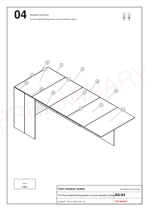
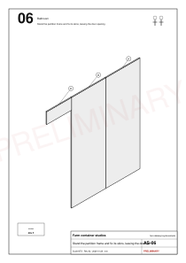
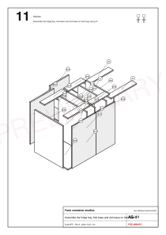
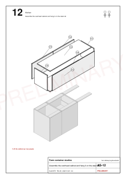
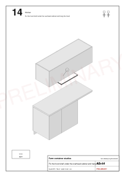
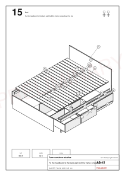
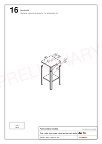
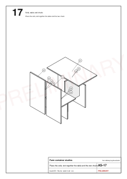
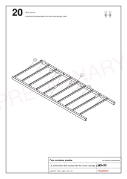
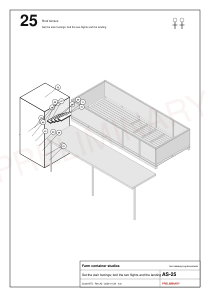

# Studio assembly

Status: rev A step drawings, generated from the model; site order for one studio. Two people unless a step says otherwise; the electrician and plumber join at the marked steps.

[Table: Assembly steps](../../public/designs/studio/data/steps.csv)

## Before the first step

- The survey is done, the set is FOR CONSTRUCTION, and the supports are level (S01).
- The shared works are ready or underway: septic tank, storage tank and booster, the site board and feeder (see [plumbing](studio-plumbing.md), [electrical](studio-electrical.md)).
- Every bundle for the studio is on site and counted.

## Step drawings

The drawings are wordless, IKEA-style: new parts in white with a heavy line, finished work in grey, part bubbles, the hardware bag and count at the bottom, and a two-person sign where needed.

Every step has its own sheet (AS-01 to AS-27) in `public/designs/studio/drawings/`, and the 3D model's step slider replays the same order.

## Commissioning and snag list

- Electrical: tests and certificate (S19). Plumbing: pressure test before lining (S05), drain fill tests, TMV temperature at the shower.
- Doors, drawers and the bathroom door swing freely; the slider locks; insect mesh is tight.
- Two consecutive hot showers (the 80 L heater test).
- Roof: the engineer's inspection is recorded before the terrace opens (S27).
- Clean, photograph each studio, and keep the as-built survey values with the set.
