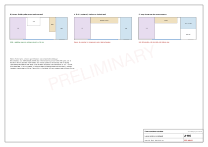
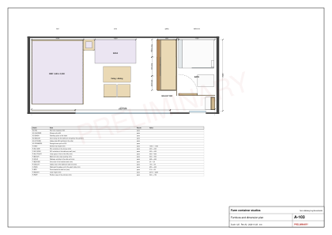
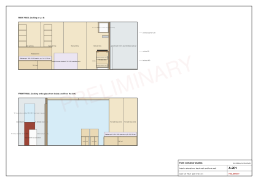
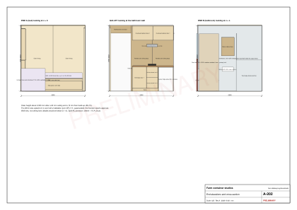

# Studio design

Status: Layout B, chosen by the founder on 2026-10-26 from two reference images (D-020). It replaces Layout A (D-015) and keeps its bathroom, which survives the photo tolerance.

## Brief

- Rentable farm-stay units for two guests: hotel-grade but durable, easy to clean between stays.
- Bed, shower, WC, basin and a kitchen that guests will actually cook in; no gas inside a steel box.
- All three identical, so one kit design, one cutting list, one manual.
- Built from materials sold in Kigali, cut and drilled in a Kigali workshop, assembled on site by a small crew.
- Keep the existing openings: a 3 m sliding glass wall and a narrow steel door.

## Options considered

Layout B reads like a small apartment in three zones, after the founder's reference plan: a bedroom, a living room with a sofa, and a galley with the bathroom behind it. The bathroom stays at the narrow-door end, and that door becomes a frosted louvre window (W1), as in Layout A. The galley runs 1.45 m along the bathroom partition, from the back wall to the bathroom door: an under-counter fridge, a two-zone induction hob and a sink, with an overhead cabinet for storage and a hood beneath it; the 30 L water heater is a box on end wall B above the WC (D-024). At end B the shower, the WC and the basin stand in one row against the end wall. A short cross wall with a 600 mm door that opens into the bathroom closes the shower and WC; the basin and its mirror cabinet stand outside the door in a small wash lobby that opens to the galley, so one guest can wash while the other uses the bathroom, and the W1 window lights the lobby. The WC is wall-hung: a 520 mm pan on a slim concealed-cistern frame, with the bathroom's end wall built out 30 mm across its full width so it stays flat, and the flush plate on that wall (no boxed-in cistern). The bathroom is only as long as the WC (550 mm from the steel, build-out included) and the 600 mm in front of it need, 1,150 mm, which gives the room about 170 mm more than Layout A's bathroom and a 1,000 x 900 shower tray. The sink, the heater, the shower, the basin and the WC still share one wet core and one drain exit. The bed goes across the quiet far end in the manner of an IKEA MALM: straight against the back wall and end A, a tall headboard, high sides and two storage boxes on castors that pull out on the room side. A bedside table with a reading lamp stands beside the head, and a wall reading light serves the wall side. The middle is a seating room: a low two-seat sofa (1.3 m wide, 0.75 m deep, 0.7 m high) on the back wall just past the bedside table, a low wide table (0.86 x 0.5 m, 0.55 m high) in front of it and two chairs facing it from the glass side, set clear of the storage boxes' pull-out. Guests enter through the sliding glass from the deck.

The reference room is 2.9 m deep; the container is 2.25 m inside, so three things changed to fit: one table and two chairs serve as both lounge and dining, instead of a coffee table plus a dining table for four; the wardrobe gives way to the bed's two storage boxes, coat hooks and a luggage rack; and, to keep the 1.3 m sofa beside the bedside table, the walkway between the sofa end and the galley worktop is about 660 mm, enough for one cook (the founder's choice over a narrower sofa). The cooker follows the founder's photo: a wide two-zone induction hob in black glass, zones side by side with knobs at the front left, under a slim black hood. Its 600 mm base and a 450 mm sink base make the galley 1.6 m long, so the walk past its end into the wash lobby is about 650 mm (the founder's choice; the check R-PASS holds it at 600 or more). Still no gas indoors.

A first version faced the WC along the container. The generator showed it failed if the glazing ended more than about 70 mm later than the photo suggests. The final arrangement faces the WC across the width, on the infill below the old door, and passes across the whole plus or minus 150 mm band. Similar layouts are common in 20 ft precedents: a bath, kitchen and bed in a row [V STU-46], a full-width bathroom [V STU-47], a bed across the end in container hotels [V STU-49] and a raised bed facing large glass [V STU-48].

## Plan

[Table: Clearance and layout checks](../../public/designs/studio/data/checks.csv)

The partition stands 1,150 mm plus its own thickness from end B, set by the bathroom, not by the glazing; it only has to land on the solid steel after the glazing, which it does by about 200 mm at the photo estimate and still by about 50 mm if the glazing ends 150 mm later. So the survey band no longer moves anything: the sofa sits 20 mm past the bedside table with a 658 mm walkway to the galley, and the table and chairs stand back from the glass so the sliding wall stays a clear entrance. The build fails, rather than drawing something unbuildable, if any keep-out zone is blocked: the WC's 600 mm front zone, the shower entry, the door swing, the storage boxes' 600 mm pull-out, and a 650 mm walkway at the galley.

## Elevations and sections

Clear height is about 2,323 mm after a 60 mm ceiling and a 10 mm floor [E, AS-15]. That is too low for ceiling fans, so the studio gets a wall fan and a sleeve and circuit for a future split AC.

## 3D model

[Studio model: layers, explode and assembly steps](../../public/designs/studio/model/studio.glb)

Use the layer switches to strip the studio back to the container, the explode slider to pull every kit apart, and the step slider to rebuild it in assembly order. Click any part to see its id, size and step.

The 3D drawing and the realistic image on the studio page are rendered from the same layout numbers (`render/scene.json`, written by the generator) by `scripts/studio/render/room.html`: one furnished room seen from the front with the front wall off, drawn once as black-and-white line art and once with materials and daylight. The furniture takes its look from product photos the founder chose (a FRIDHULT-style sofa, a MALM-style bed, a LACK-style table, a vessel basin on a black console, a square wall-hung-style WC, a frameless shower screen); sizes, layout and the bill of materials stay as designed. Pillows, throws, cushions, towels, books and plants are render-only props.

## Finishes

| Surface | Finish | Why |
|---|---|---|
| Walls and ceiling (living) | 12 mm ply, vapour-retarding primer and off-white paint | Light and calm; the primer seals the insulation from room air; repaintable |
| Floor (living) | Epoxy seal over the treated container floor, then 5 mm SPC in a natural oak decor without knots (narrow random-length planks) | The original floor is insecticide-treated; never sand it [V STU-07] |
| Bathroom walls | Cement board, liquid membrane, ceramic tiles | Fully waterproof; easy to clean between guests |
| Bathroom floor | Safety vinyl coved 100 mm up the walls, low-profile tray | No joints at the floor; the tray keeps IP zone 1 small [V STU-38] |
| Furniture | Pine in medium oak, after the founder's bed reference: 18 mm pine-faced ply or solid pine, a medium-oak stain under clear matte PU varnish; golden amber with a soft patina and fine grain, select-grade pine with few, small knots, ABS edges; marine ply in the bathroom | The founder's reference finish; Kigali carpenters work pine every day; warm against off-white walls and the oak floor |
| Worktop | 38 mm laminate or hardwood | Field check (AS-24) |
| Outside | Existing paint kept; steelwork for the roof painted to match | Founder did not ask for a repaint |
