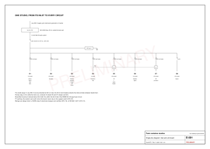
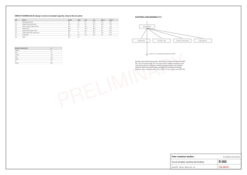
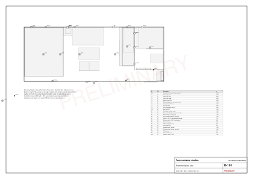

# Studio electrical

Status: design intent. Every rating is an assumption [A, AS-19] until a RURA-licensed electrician (class A covers homes [V STU-15]) designs, installs and certifies the installation to RS 565-1:2011, the wiring standard RURA's regulations require [V STU-14]. Kigali has enforced certified installers since 2020 [V STU-52].

## The studio plugs in (D-021)

- Each studio is wired as a closed unit with one connection: a 32 A IP67 inlet (IEC 60309 blue, 2P+E) outside the back wall, straight behind the unit board, with 6 mm2 tails through a gland to a 32 A double-pole main breaker (C curve) and a DIN kWh check meter. A matching plug ships with it.
- 32 A is the IEC 60309 size that site boards, generators and inverters offer [E]. The studio's diversified demand is 30 A [E, AS-19] once the AC joins the priority relay, so it fits.
- Any 230 V source can feed the inlet (the site board, a generator or a solar inverter) as long as it protects its own cable at 32 A or less. The studio's main breaker protects the inlet and its tails whatever feeds them.
- The studio keeps its own earth rod (TT), so it never relies on the supply's earth [V STU-37].

## Feeding the inlet (a site decision)

- REG grid at 230 V, 50 Hz [V STU-18]. A new low-voltage connection within 37 m of the network was listed at 56,000 Frw [V STU-P05, undated].
- REG installs and owns the meters [V STU-16], and re-selling power may need a licence, so the per-unit meters are **check meters for monitoring only**; electricity is included in the room rate.
- If a site board feeds the studios, give each its own feeder protected at 32 A or less, and ask REG whether the supply covers the studios plus the borehole and booster pumps (about 30 A per studio diversified, plus the pumps) [E]. The supply cable is sized on site, once the source is chosen.

## Unit board and circuits

- **The board** has 24 modules in two rows of 12: the main breaker and check meter, a type 2 surge protection device, the priority relay and its contactor, and one RCBO (30 mA, type A) per circuit. With an RCBO each, a fault trips only its own circuit: a wet roof light no longer darkens the room or stops the fridge.
- **The circuits:**
  - C1: indoor lights and both fans.
  - C2: sockets at the bed, the sofa and the deck.
  - C3: kitchen sockets, the fridge and the hood. The socket above the hood also takes the Wi-Fi router.
  - C4: the induction hob.
  - C5: the 30 L water heater, a box above the WC (D-024); its switch and timer stay outside the bathroom, on the galley side of the partition.
  - C6: the outdoor lights (deck, stair and roof), on their own circuit.
  - C7: AC provision.
  - C8: a spare way.
- **The priority relay** senses the hob (C4). While the hob runs, its contactor pauses the heater (C5) and the AC (C7).
- **Maximum demand:** lights 0.3 A + fans 0.3 A + sockets 16.4 A + the larger of the hob (11.6 A) or the heater and AC together (8.7 + 4.3 A) = 30.0 A [E].

[Table: Circuits (design current, derated capacity, run length, voltage drop)](../../public/designs/studio/data/circuits.csv)

[Table: Diversified maximum demand per studio](../../public/designs/studio/data/demand.csv)

The generator checks every circuit for design current within the breaker within the derated cable capacity, and a voltage drop under 3% for lighting and 5% for the rest [E]. Capacities are for conduit inside the foam-insulated lining (IEC 60364-5-52 method A1), derated for a 35 C box; every circuit passes on them. Cable data are typical IEC values for PVC copper; confirm them against the cable actually bought (Legend Cables makes cable in Kigali [V STU-34]).

## Points and routes

Cables run in 20 mm conduit in the lining: up from the board into the ceiling void, along it, then straight down to each device. The conduit and cable lengths and the voltage drops come from these drawn routes [E]. C6 leaves through one gland in the solid front strip at the bed end and runs outside in UV-stable conduit.

Changes on 2026-10-27, after checking every point against the layout:

- **Off the glass:** the entry switches (S1, and S5 for the deck light) and the deck socket (P5) were on the slider glass. They are now on the solid strip just past the slider.
- **Deck light (L8):** it sat above the veranda canopy, so it would have lit the canopy. It now hangs under the canopy on the veranda ledger.
- **Living sockets:** the socket at the bed's foot (P4) is gone. The sofa socket (P3) moved from behind the sofa to above its arm, with USB-C, for the sofa and the table.
- **New points:**
  - the hood gets a double socket (P12), shared with the Wi-Fi router;
  - the stair and roof lights switch at both ends of the stair (S4, S6);
  - the smoke and heat alarms (AL1, AL2) and the earth rod (E1) now have positions.
- **Hob outlet (P9):** it has no switch of its own. It is isolated at its RCBO, on the board about 0.9 m away and in sight; the electrician confirms this.

[Table: Points, circuits and mounting heights](../../public/designs/studio/data/points.csv)

## Earthing, bonding and lightning

- TT earthing with one earth rod per container. Bond the container body, the front deck, the stair and the roof steelwork to the unit's main earthing terminal. A steel box with a chafed live cable is lethal; bonding is not optional. UK guidance for steel units says to avoid a combined neutral-earth (PME) supply unless under skilled supervision [V STU-37].
- Lightning exposure at the site is still unknown [U] and should be measured (`electrical-system.md`). Each studio board has a type 2 SPD; a site board, if one feeds the studios, carries the type 1+2.
- Bathroom: an IP65 light and an IPX4 extract fan (it sits in zone 1, above the tray and below 2.25 m [V STU-38]), no sockets, switched from outside the door, and every circuit on its own 30 mA RCBO.

## Tests before power-on

- Continuity of protective conductors, insulation resistance, polarity, earth-electrode resistance (record it), and every RCBO's trip time.
- SPD status, and the priority relay: the heater and the AC must drop out while the hob runs.
- Then the electrician's certificate.

Smoke and heat alarms are tested at handover (see [permits, safety and handover](studio-permits.md)).
