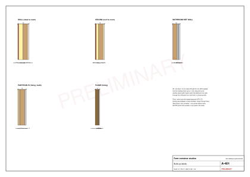

# Studio envelope

Status: design intent; the opening frame is checked in the survey.

A steel box in the sun is the main comfort problem. Kigali's relative humidity runs from about 55% in July to 80% in November, with clear nights [V STU-05]; the candidate farm zones are a little lower and warmer (mean 19.5-21.6 C, LOC-35). On clear nights the bare steel cools below the dew point and sweats [V STU-04]. The envelope therefore does three things: keep the sun off the steel, keep room air away from the steel, and let the bathroom's moisture out.

## Shade first

The roof terrace deck sits about 150 mm above the container roof on its own beams, so the deck boards shade the steel and air moves through the gap: a ventilated double roof, the single strongest heat measure (a double metal roof with insulation cut heat transfer by about 77% in small test boxes [V STU-44]). Layout B drops the canopy over the terrace (D-020), so the deck is the only shade on the roof. The canopy over the front deck shades the 3 m glass wall. See [roof terrace](studio-roof.md).

## Walls and ceiling

1. Clean the steel, treat rust, zinc-prime.
2. Fill the corrugation valleys (36 mm deep on the side walls [V STU-02]) with EPS strips bonded in PU foam, so no air pocket touches the steel.
3. Screw 38 x 50 treated battens to the inner peaks at 600 mm.
4. Fit EPS (sold in Kigali in 1.2 x 1.2 m boards [V STU-19]) between the battens; foam-seal every joint.
5. Fix the numbered 12 mm ply panels; their socket and switch openings are cut in the workshop.

The steel is a vapour barrier on the outside, so the wall can only dry inward: no voids against the steel, airtight linings, and a vapour-tight bathroom [V STU-06]. No XPS or spray-foam supplier was found in Rwanda (searched 2026-10-26), so the design uses EPS throughout.

## Floor

The 28 mm container floor is insecticide-treated [V STU-02, STU-07]. Seal it with primer and a 100%-solids epoxy (Ameki sells epoxy floor paint, STU-22; confirm the solids content), then lay 5 mm SPC on an underlay. No insulation under the floor: at 16-28 C it buys little and is hard to fit [E].

## Openings and ventilation

- **W1, the old narrow door:** the leaf comes off; 2 mm steel with 40 mm EPS is welded into the frame up to 1,150 mm, and an obscure louvre window with insect mesh goes above. W1 now lights the wash lobby. The bathroom's 100 mm extract fan leaves through one 110 mm hole in the back wall, inside the rule below (at most 152 mm, one per 2.44 m) and about 4 m from the AC sleeve.
- **No new windows in the back or end walls.** Those walls now brace the box; any new hole there is at most 152 mm, one per 2.44 m [V STU-03]. The only ones planned are a 75 mm sleeve for a future split AC and a 110 mm hole for the bathroom fan.
- **Ventilation targets:** whole unit 13 L/s, bathroom extract 15 L/s, trickle vents 10,000 mm2 [V STU-08, UK guidance]. The louvred vent strip, the W1 louvre and the slider give cross-ventilation; a wall fan moves air at the bed.
- **Insect mesh** on the slider, W1 and every vent.
- **Security:** a keyed lock and a secondary bolt on the slider, the only door.

## End B

On the yellow unit, end B is the cargo-door end. The bathroom's wet wall there is an independent stud wall inside the doors, never the doors themselves; the doors are sealed and locked (or tack-welded). The survey records the end-B condition on the red units.
