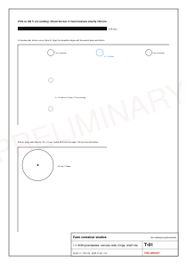

# Studio flat-pack system

Status: design rules for every kit; hardware stock in Kigali still to be confirmed in person (AS-24).

IKEA's approach rests on flat parts, few fastener types, a number on every part, a bag of hardware per module and wordless step drawings; its own rule is that a product not designed for easy assembly cannot be saved by an instruction [V STU-40, STU-41]. This page applies that to a Kigali workshop and a two-person site crew.

## Design for a panel saw first

No full-sheet CNC router job shop was found in Kigali (searched 2026-10-26): the WSH Makerspace has laser cutters and a small CNC mill [V STU-28], FabLab Rwanda lists no equipment [V STU-29]. Gisozi (Agakiriro) is the furniture and carpentry cluster [V STU-30], where panel saws and edge banders are the norm. So:

- **Every part is a rectangle.** Cutting is two-stage guillotine: rip the sheet into strips, then crosscut the strips. The cutting diagrams (C-sheets) follow exactly that order, so they work on any panel saw.
- **Every machine hole is on a panel face.** If a CNC router turns up, the same layouts feed it (one DXF per sheet in `public/designs/studio/cnc/`, layers named by tool: `DRILL_D35_Z13` is a 35 mm hole 13 mm deep).
- **Edge holes** (the matching pilot and dowel holes in panel edges) are drilled by hand with a bushed jig; the 1:1 templates (T-01) give every pattern.

## One board, one grid, one hardware family

| Rule | Choice | Why |
|---|---|---|
| Boards | 18 mm for all furniture and partitions; 12 mm ply for linings and carcass backs; 18 mm marine ply in the bathroom | Two thicknesses keep the cutting list short; marine ply resists splashes |
| Grid | System 32: 5 mm holes on a 32 mm pitch, 37 mm from the front edge [V STU-42] | Hinges, runners and shelf pins all land on the same rows |
| Fixed joints | Confirmat 7 x 50 plus two 8 mm dowels per joint | Strong, forgiving, one stepped drill |
| Joints that come apart | M6 connector bolt with a 10 mm barrel nut (bed, wardrobe) | Re-assembly without wear; a cam (Minifix 15) is the alternative [V STU-43] |
| Doors | 35 mm soft-close cup hinges on the 37 mm row | Standard; adjustable after install |
| Drawers | 45 mm ball-bearing runners; bed drawers on castors | Fewer precise parts under the bed |
| Edges | 2 mm ABS on visible edges, 0.8 mm on hidden ones | Durable for guest use |
| Tools | PZ2 driver, 4 and 5 mm hex keys, drill with 5/7/8/10 mm bits and Forstner 15/35 with depth stops, level, mallet | One kit for the whole studio |

If confirmat screws are not stocked, the fixed joints use dowels plus 4.5 x 50 wood screws in the same holes.

## Numbers, bags and steps

- Every part has an id such as `K3-H-07`: kit 3 (kitchen), hob base, part 7. The id is written on a hidden face in the workshop and appears on the cut list, the kit sheet, the step drawings and in the 3D model.
- Hardware is packed in bags A to L; each step drawing shows which bag and how many.
- Steps are wordless isometric drawings: new parts in white with a heavy outline, finished work in grey, part bubbles, hardware counts, a two-person sign where a part needs two people.

[Table: Hardware bags](../../public/designs/studio/data/hardware.csv)

## Fit to a box that is not square

Containers are rarely square: diagonals may differ by up to 13 mm when new [V STU-02]. Every junction between furniture and wall has a 40 mm scribe strip cut on site; furniture fixes only to battens and blocking, never to the steel; carcass sides are drilled symmetrically, so left and right sides are the same part. Parts are sized to the smallest of the three surveyed units, and each unit gets its own filler strips.
