# Studio kits

Status: rev A part lists from the model; sizes final only after the survey.

One studio is eleven kits. K1 to K7 are flat-pack woodwork from the carpentry workshop; K8 and K9 are the electrician's and plumber's materials, pre-cut and labelled; K10 and K11 come from a steel workshop.

[Table: Kits per studio](../../public/designs/studio/data/kits.csv)

## Woodwork kits

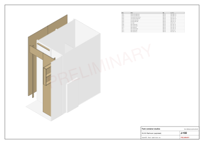

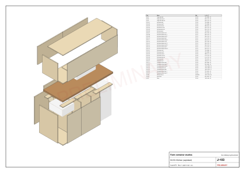

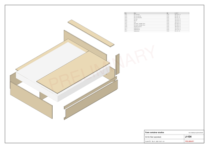

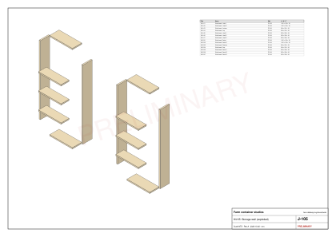

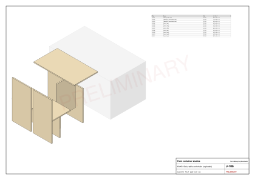

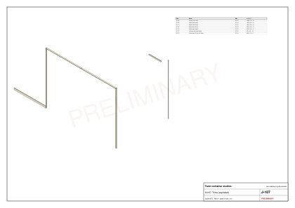

## Roof kit

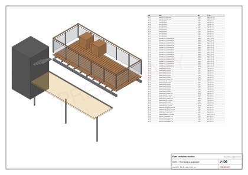

## Cutting diagrams

One studio takes 11 sheets of 18 mm board, 16 of 12 mm ply, 3 of 18 mm marine ply and one worktop blank [E, generated]. The diagrams are drawn in cutting order: rip along the red lines first, then crosscut.

[Table: Sheets and yield](../../public/designs/studio/data/nesting.csv)

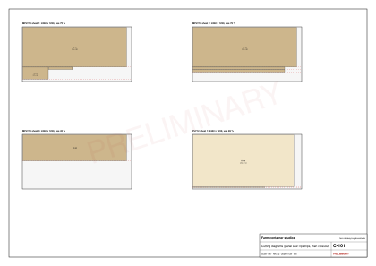

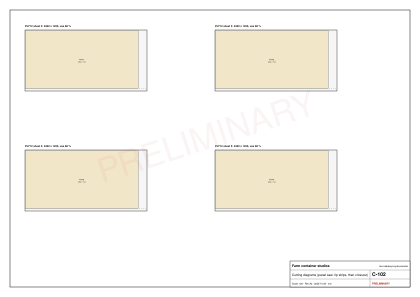

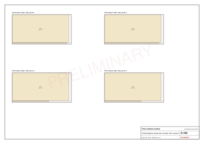

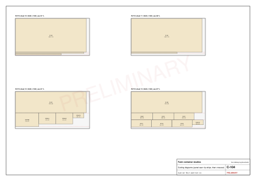

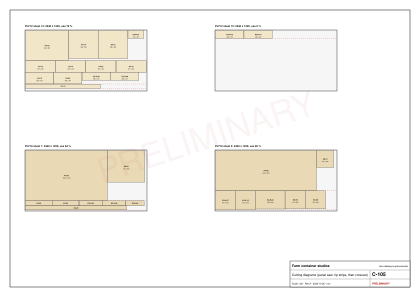

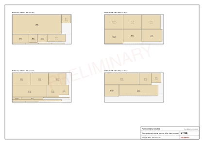

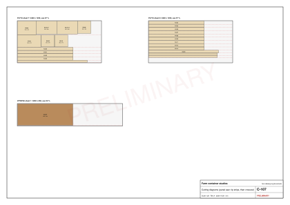

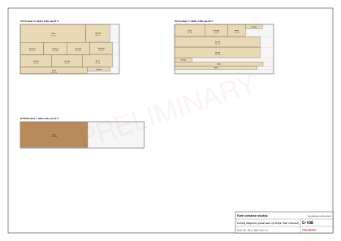

The full cut list, with edge banding and machining counts per part, is on the [cut list page](../../public/designs/studio/data/cut-list.csv).
