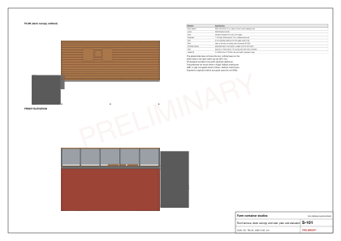

# Studio roof terrace

Status: concept with indicative member sizes. **No guest uses the roof until a structural engineer has checked and signed it** (R26). Loads are assumptions [A, AS-23].

The founder asked for a transparent shade and simple use of the roof, such as chairs. Each studio gets its own roof terrace with two lounge chairs and a side table, open to the sky behind a simple guardrail, a canopy over the front deck, and a straight steel stair with a landing. The founder dropped the canopy over the terrace and asked for an open post-and-rail like the reference photo, but kept the stair, since guests climb it at night (D-020).

## How the load gets down

- A container roof is commonly quoted as tested for about 300 kg over 600 x 300 mm (ISO 1496-1 roof test; standard not read) [A], so nothing stands on the roof skin.
- The glazed side no longer braces the box [V STU-03], so nothing bears on the slider head or the open side's top rail either.
- Two longitudinal RHS 150 x 100 x 5 beams sit only on the four corner castings, which carry stacking loads by design. Joists (RHS 80 x 40 x 3 at 600) span between them; hardwood deck boards sit on the joists.
- The guardrail posts bolt to the deck beams; the veranda canopy stands on its own posts on the deck frame.
- Sideways load (wind on the deck canopy, people leaning on the rail) goes into the frame's own bracing and the strong end walls, which carry about 12.3 kN/m in racking against 2.45 kN/m for a side wall [V STU-03].

## Specification

[Table: Roof kit steel and timber list](../../public/designs/studio/data/steel-list.csv)

| Element | Choice |
|---|---|
| Deck | Treated hardwood 140 x 25 with 5 mm gaps; about 100 mm air gap over the roof (ventilated shade) |
| Guardrail | 1,100 mm high: SHS 50 x 50 posts at 1.5 m or less, a hardwood top rail, 4 mm stainless cables at 90 mm so no gap is 100 mm or more (children) |
| Roof | Open to the sky: no canopy over the terrace (D-020); the deck itself still shades the container roof |
| Veranda canopy | 10 mm tinted multiwall polycarbonate over the front deck, falling outward, on independent posts and a ledger, gutter at the front |
| Stair | Dog-leg: two flights of 8 risers of about 175 mm, 250 mm goings, 850 mm wide, handrails both sides, landing at mid-height, at end A |
| Bonding | All steelwork bonded to the unit's earth electrode (Rwanda's lightning risk) |
| Design loads | 3.0 kN/m2 on the deck, 0.74 kN/m on the rail, deck-canopy uplift per local practice [A, AS-23] |

Rainwater from the deck canopy runs to the shared storage tank through a first-flush diverter (see [plumbing](studio-plumbing.md)).

## Material availability

No polycarbonate supplier was found online in Kigali (searched 2026-10-26). If multiwall polycarbonate cannot be found, the fallback is a translucent GRP or opal corrugated sheet from the roofing factories in Masoro (Tolirwa, STU-20; Safintra, STU-21), checked in person. The deck canopy frame works with either.

## Permits

The founder reports that the containers are already approved. A roof terrace, a stair and a deck canopy may count as a change; ask the sector One Stop Centre whether the approval needs an amendment before the roof kit is fabricated (R29). Permits now go through KUBAKA [V STU-13].
