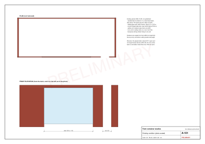

# Studio site and survey

Status: the existing condition below is read from the founder's photo of 2026-10-25 (not published: photos can carry GPS data). Every number from it is an estimate [E, AS-14] scaled from the 6,058 mm container length [V STU-01].

## What is on site

- Three standard-height 20 ft containers, two red and one yellow, external 6,058 x 2,438 x 2,591 mm [V STU-01].
- Each sits on a red steel deck frame about 700 mm above the ground [E], with a film-faced deck along the front long side, railings, and steps at end B.
- Identical openings on the front long side (confirmed by the founder): a sliding glass wall about 3.0 x 2.25 m mid-front, and a narrow hinged steel door about 0.55 m wide near end B [E].
- The yellow unit still has its cargo doors at end B. The other two are to be checked.
- One container's corner casting rests directly on a rock.
- Wiring is temporary (bulbs on flex). One unit has a horizontal timber lining and loose furniture inside.
- Utilities reported by the founder: REG grid, WASAC water, a borehole and rainwater; no septic system.

## Why the survey comes first

The photo estimates carry about plus or minus 150 mm. The model absorbs that band (the galley aisle is the slack, and the tests run the glazing end at -150, 0 and +150 mm), but panels are cut once. Nothing is cut until all three units are measured and the set is rebuilt; the drawings carry a PRELIMINARY stamp until then.

Two checks matter beyond dimensions:

- **Structure.** The glazed side is about 60% open, more than the 50% at which a corrugated wall still counts as bracing [V STU-03]. The back wall, the end walls and whatever frame was welded around the 3 m opening now carry all racking. Photograph and measure the header and jambs over the opening.
- **Level and bearing.** All four corner castings must bear on a solid, level support (plus or minus 5 mm). The rock corner must be padded or shimmed before the fit-out, or doors bind and tiles crack (R28). The roof terrace adds load, so this is not optional.

## The survey sheet

Fill `study/studio/survey.csv`, one row per item per unit (U1, U2), in mm, measured from the steel faces; the third box is the office and is not surveyed here. Then run `pnpm studio:build`. The generator takes the smaller value of the two units for kit sizing, recomputes every drawing, list and check, and lifts the PRELIMINARY stamp once every row has a value.

[Table: Survey items](survey.csv)

Also record, per unit, with photos: the CSC plate (including the timber-treatment line), corrosion at the floor edges and the roof, the end-B condition (cargo doors or a wall), the existing lining and wiring, and the floor cross-member spacing seen from below (the drains must pass between them).

## Siting checks for the shared works

These are not visible on the photo and need a site plan:

| Check | Rule | Source |
|---|---|---|
| Containers and septic from the lake | No building within 50 m of the lake | [V LOC-01, LOC-02] |
| Septic and soak pit from the borehole | At least 50 m (2012 rules); soak pit at least 18 m (2019 draft) | [V STU-11, STU-10] |
| Septic from buildings and the boundary | At least 3 m (2012); drain field 15 m in UK practice | [V STU-11, STU-09] |
| Tanker access | Within 30 m of the septic tank | [V STU-09] |
| Groundwater and soakage | Soak pit only if groundwater is more than 2.5 m down and percolation 25-125 mm/h | [V STU-10] |
