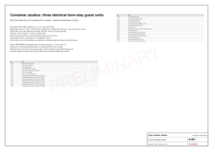

# Container studios

Status: PRELIMINARY, rev A, 2026-10-26. Openings are photo estimates until the [site survey](studio-site.md) is filled in. Decisions: D-014, D-016, D-020 (Layout B, which replaced D-015) in the [decision log](../execution/decision-log.md).

Three standard 20 ft shipping containers already stand on the site, each on a raised steel deck, with identical openings. This section turns all three into identical farm-stay guest studios: a queen bed, a shower, a WC and basin, a small kitchen with an induction hob, and a roof terrace under a transparent shade. The interior is built the IKEA way: flat panels cut and drilled in a Kigali workshop, numbered, packed one kit per studio, and assembled on site with one small hardware family and wordless step drawings.

Everything on these pages comes from one parametric model (`scripts/studio/`). The plans, the 3D model, the cutting lists, the circuits, the pipe runs and the bill of materials can never disagree, and the whole set regenerates in seconds when the survey numbers arrive (`pnpm studio:build`).

[The furnished studio (front wall and roof removed)](../../public/designs/studio/model/studio.glb)

## What each studio gets

| Item | Specification |
|---|---|
| Interior | About 5,798 x 2,252 x 2,323 mm net (13.1 m2) after insulation and lining [E, AS-13, AS-15] |
| Bed | Queen bed up to 1,600 x 2,000 in the MALM manner, against the back wall and end A: tall headboard with USB-C, two storage boxes on castors; a bedside table with a reading lamp, a wall reading light |
| Kitchen | 1.45 m galley on the bathroom wall: under-counter fridge, two-zone induction hob, sink; an overhead cabinet holds the 80 L water heater |
| Bathroom | Shower, WC and basin in one row on end wall B: a 1,000 x 900 walk-in shower and a wall-hung WC (concealed cistern, flush plate on the wall) behind a 600 mm door; the basin and mirror cabinet outside it in a wash lobby under the W1 window |
| Seating | Low two-seat sofa, a low wide table and two chairs by the 3 m sliding glass wall, coat hooks and a luggage rack, wall fan, split-AC provision |
| Envelope | EPS between battens, 12 mm ply linings, sealed floor with SPC, insect mesh everywhere |
| Outside | Roof terrace with chairs on the corner castings behind an open guardrail (steel posts, hardwood top rail, stainless cables), tinted polycarbonate over the front deck, straight steel stair with a landing |
| Services | REG grid, own unit board with SPD and 30 mA RCD, about 33 A demand; WASAC/borehole/rain via a shared tank and booster; shared septic tank |

## How to read the package

1. [Site and survey](studio-site.md): what is there, and the measurement sheet that must be filled before anything is cut.
2. [Design](studio-design.md): the options, the chosen layout and every drawing.
3. [Envelope](studio-envelope.md) and [roof terrace](studio-roof.md): heat, condensation, structure.
4. [Flat-pack system](studio-flatpack.md) and [kits](studio-kits.md): how the IKEA pattern works here, part by part.
5. [Electrical](studio-electrical.md) and [plumbing and sanitation](studio-plumbing.md): circuit and pipe diagrams.
6. [Sourcing](studio-sourcing.md), [fabrication](studio-fabrication.md), [assembly](studio-assembly.md): where to buy, where to make, how to put together.
7. [Bill of materials](studio-bom.md), [budget and schedule](studio-budget.md), [permits, safety and handover](studio-permits.md).

## Downloads

- Print: [A3 drawing set (PDF)](../../public/designs/studio/pdf/studio-drawing-set-A3.pdf), [A4 assembly manual (PDF)](../../public/designs/studio/pdf/studio-assembly-manual-A4.pdf), [1:1 drilling templates (PDF)](../../public/designs/studio/pdf/studio-drilling-templates-1to1.pdf)
- Drawing index: [drawings.csv](../../public/designs/studio/data/drawings.csv) (every sheet, SVG, open in any browser)
- 3D model: [studio.glb](../../public/designs/studio/model/studio.glb) and [parts.json](../../public/designs/studio/model/parts.json)
- Workshop: [cut-list.csv](../../public/designs/studio/data/cut-list.csv), [steel-list.csv](../../public/designs/studio/data/steel-list.csv), CNC files in `public/designs/studio/cnc/` (one DXF per sheet)
- Money: [bom.xlsx](../../public/designs/studio/data/bom.xlsx), [bom.csv](../../public/designs/studio/data/bom.csv)
- Checks the model passes: [checks.csv](../../public/designs/studio/data/checks.csv)

## Budget band

About RWF 15.8M per studio and RWF 53M for all three with the shared septic, water and power works and 15% contingency [E from placeholders, AS-21]. Only about 2% of that comes from published prices; the rest are placeholders until three quotes per line arrive. A turnkey container house is listed at RWF 24-42M each [V STU-P04], so the flat-pack route is worth pursuing only if the quotes keep it well below that. See [budget](studio-budget.md).

## What must happen before money is committed

- Fill the [survey sheet](studio-site.md) for all three containers and rebuild the set (the drawings lose the PRELIMINARY stamp only then).
- File the approval reference the founder reports, and ask whether the roof terrace, stair and deck canopy need an amendment (R29).
- Find a septic site 50 m from the borehole and the lake, and run a percolation test (D-016, R27).
- Get three quotes for every BOM line, starting with boards, sanitaryware and the steelwork.
- A structural engineer checks the opening frame and signs the roof terrace before guests use it (R26).
